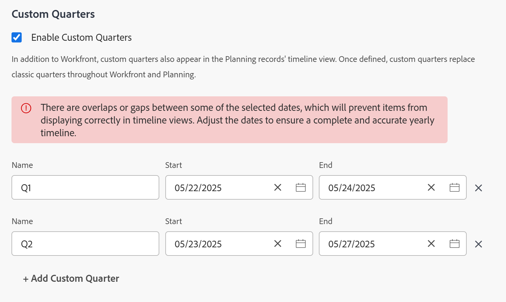
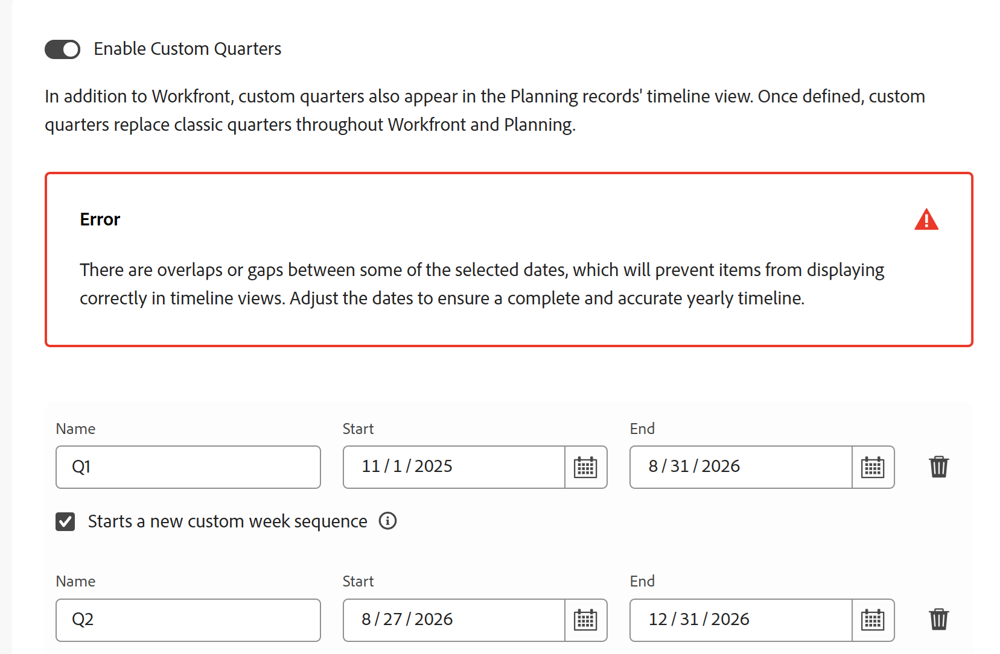

# カスタム四半期と週を有効にする

<!--Audited: 03/2026-->

<!--remove Production and Preview references at release-->

<!--

The highlighted information on this page refers to functionality not yet generally available. It is available only in the Preview environment for all customers. After the monthly releases to Production, the same features are also available in the Production environment for customers who enabled fast releases.    

For information about fast releases, see [Enable or disable fast releases for your organization](/help/quicksilver/administration-and-setup/set-up-workfront/configure-system-defaults/enable-fast-release-process.md). 
-->

レポートの目的で、組織の四半期がカレンダーの日付（営業日や買い物日など）以外の特定の条件に基づいている場合は、カスタム四半期を作成できます。

会社が購入した商品に応じて、Workfrontの設定領域で次の数の四半期を設定できます。

* [!DNL Workfront]のみを購入したお客様は、[!DNL Adobe Workfront] システムに対して最大8つのカスタム四半期を設定できます。
* [!DNL Workfront]および[!DNL Workfront Planning]を購入したお客様は、ご使用の[!DNL Workfront] システムに対して最大100 クォーターを設定できます。このクォーターは[!DNL Planning]でも利用できます。

* [!DNL Workfront]および[!DNL Workfront Planning]を購入したお客様は、カスタム四半期ごとにカスタム週を設定できます。 カスタム週は、[!DNL Planning] タイムラインビューに表示されます。

## アクセス要件

+++ 展開すると、この記事の機能のアクセス要件が表示されます。

<table style="table-layout:auto"> 
 <col> 
 <col> 
 <tbody> 
  <tr> 
   <td>[!DNL Adobe Workfront] パッケージ</td> 
   <td>
任意
</td> 
  </tr> 
  <tr> 
   <td>[!DNL Adobe Workfront] ライセンス</td> 
   <td>
[!UICONTROL Workflow Standard]または[!UICONTROL Workfront プラン &#x200B;] ライセンス

       

</td>
  </tr> 
  <tr> 
   <td>アクセスレベル設定</td> 
   <td>[!UICONTROL System Administrator]</td> 
  </tr> 
 </tbody> 
</table>

詳しくは、[Workfront ドキュメントのアクセス要件](/help/quicksilver/administration-and-setup/add-users/access-levels-and-object-permissions/access-level-requirements-in-documentation.md)を参照してください。

+++

<!--
When we release fiscal weeks, replace the table above with this:

<table style="table-layout:auto"> 
 <col> 
 <col> 
 <tbody> 
  <tr> 
   <td>[!DNL Adobe Workfront] package</td> 
   <td>
   <ul>
   <li>
To configure custom quarters:

   
Any Workfront or Workflow package
</li>
   <li>
   

   
To configure custom weeks:

   
Any Planning package, including Planning as a standalone product

   

   </li>
   </ul>
   </td> 
  </tr> 
  <tr> 
   <td>[!DNL Adobe Workfront] license</td> 
   <td>
   
   <ul>
   <li>
To configure custom quarters:

   
[!UICONTROL Workflow Standard] or [!UICONTROL Workfront Plan] license
</li>
   <li>
   

   
To configure custom weeks:

   
A [!UICONTROL Planning Standard] license, in addition to a Workfront or a Workflow license

   

   </li>
   </ul>
    </td>
  </tr> 
  <tr> 
   <td>Access level configurations</td> 
   <td>[!UICONTROL System Administrator]</td> 
  </tr> 
 </tbody> 
</table>

-->

## [!DNL Workfront] システムのカスタム四半期を設定する

<!--
Setting up custom quarters differs depending on which environment you use. 

### Set up custom quarters for your [!DNL Workfront] system in the Production environment

{{step-1-to-setup}}

1. Click **[!UICONTROL Custom Quarters]**.

1. Select **[!UICONTROL Enable Custom Quarters]**.

1. Type a name for the custom quarter, such as "Fiscal Q1 2021."
1. Select start and end dates for the custom quarter.

   

1. (Optional) Click **[!UICONTROL Add Custom Quarter]** to add additional custom quarters to the system.

      >[!IMPORTANT]
      >
      > If your company purchased [!DNL Workfront Planning], you cannot save your custom quarters if there are gaps or overlaps between the quarters. 
      >
      >Gaps and overlaps between the quarters are allowed for [!DNL Workfront] only customers. 

1. (Optional and conditional) If your company purchased only [!DNL Workfront], without [!DNL Workfront Planning], create a reporting element that refers to the fiscal quarters.

   **Example:** Create a filter for a [!UICONTROL project] list and include the Planned Completion Date of a project referencing the custom quarters.

   

   The references to "This Quarter", "Next Quarter", and "Last Quarter" are replaced with new references to the custom quarters.

   For information about reporting elements, see [Reporting elements: filters, views, and groupings](../../../reports-and-dashboards/reports/reporting-elements/reporting-elements-filters-views-groupings.md).

   For information about creating filters, see [Create or edit filters in [!DNL Adobe Workfront]](../../../reports-and-dashboards/reports/reporting-elements/create-filters.md).
1. (Optional and conditional) If your company purchased Workfront Planning and you have access to [!DNL Workfront Planning], go to a record type page and open a timeline view. The view displays the new custom quarters. 
For information, see [Manage the timeline view](/help/quicksilver/planning/views/manage-the-timeline-view.md). 

### Set up custom quarters for your [!DNL Workfront] system in the Preview environment

-->

>[!NOTE]
>
>組織がワークフローパッケージに加えてプランニングパッケージを購入した場合、またはWorkfront Planningをスタンドアロンパッケージとして購入した場合は、カスタム四半期に加えてカスタム週を設定できます。
> 
>カスタム週は、Workfront レポートとリストでは使用できません。

{{step-1-to-setup}}

1. **[!UICONTROL カスタム四半期]**&#x200B;をクリックします。

1. 「**[!UICONTROL カスタム四半期を有効にする]**」を選択します。

1. カスタム四半期の名前を入力します。 例えば、「2021年度第1四半期」とします。
1. カスタム四半期の開始日と終了日を選択します。

1. （オプション）「**新しいカスタム週シーケンスを開始する**」オプションを選択します。

   このオプションを選択すると、プランニングタイムラインビューで、四半期の最初のカスタム週の開始として、カスタム四半期の開始が設定されます。
1. （オプション）「**カスタム週ラベル形式**」領域で、カスタム週ラベルの&#x200B;**形式**&#x200B;を選択します。 次のオプションから選択します。

   * **W1、W2、W3 ...**。 これはデフォルトの形式です。
   * **FW1、FW2、FW3 ...**
   * **第1週、第2週、第3週、...**
   * **カスタム**

1. （条件付き） **形式** フィールドに&#x200B;**カスタム**&#x200B;を選択した場合は、**カスタムラベル**&#x200B;を入力して、カスタム週を識別します。

   プランニングタイムラインビューにカスタム週が表示されます。

   >[!TIP]
   >
   >カスタムラベルを追加する場合は、最大100文字まで入力できます。
   >
   >最初の週の名前を指定できます。次の週では、同じラベルの後に連続番号を使用します。
   >
   >例えば、「会計週」の&#x200B;**カスタムラベル**&#x200B;は、「会計週1、会計週2、会計週3 ...」のラベルを追加します。 シーケンスの残りの週に送信されます。

1. （オプション）「**[!UICONTROL カスタム四半期を追加]**」をクリックして、システムにカスタム四半期を追加します。

   >[!IMPORTANT]
   >
   > 会社が[!DNL Workfront Planning]を購入した場合、四半期の間にギャップまたは重複がある場合は、カスタム四半期を保存できません。
   >
   >四半期間のギャップと重複は、[!DNL Workfront]人のお客様に対してのみ許可されます。

1. （オプションおよび条件付き）Workfrontでカスタム四半期を表示するには、カスタム四半期を参照するレポート要素を作成します。

   **例：**&#x200B;[!UICONTROL プロジェクト]リストのフィルターを作成し、カスタム四半期を参照するプロジェクトの予定完了日を含めます。

   

   「今四半期」、「次四半期」、「前四半期」の参照は、カスタム四半期の新しい参照に置き換えられます。

   レポート要素について詳しくは、[レポート要素：フィルター、ビュー、およびグループ化](../../../reports-and-dashboards/reports/reporting-elements/reporting-elements-filters-views-groupings.md)を参照してください。

   フィルターの作成について詳しくは、[フィルターを作成または編集 [!DNL Adobe Workfront]](../../../reports-and-dashboards/reports/reporting-elements/create-filters.md)を参照してください。
1. （オプションおよび条件付き）Workfront Planningでカスタム四半期および週を表示するには、レコードタイプページに移動してタイムラインビューを開きます。 ビューには、新しいカスタム四半期と週が表示されます。

   詳しくは、[タイムラインビューの管理](/help/quicksilver/planning/views/manage-the-timeline-view.md)を参照してください。

