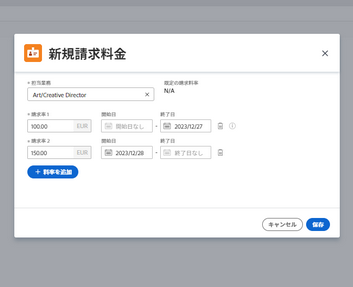

# 会社レベルでの担当業務請求率の上書き

担当業務を作成する際に、その役割の時間単位の請求率を選択するオプションがあります。 1 つの会社に固有の複数の時間単位の請求レートを作成できます。 各請求レートは、特定の日付範囲に対して有効です。

プロジェクトレベルでは、会社レベルの請求率でプロジェクトレベルの請求率を上書きするオプションを有効にできます。 詳しくは、[プロジェクトレベルの請求率を会社レベルの請求率で上書きする](../../../manage-work/projects/project-finances/override-project-level-with-company-level-billing-rates.md)を参照してください。

## アクセス要件

+++ 展開すると、この記事の機能のアクセス要件が表示されます。

<table style="table-layout:auto"> 
 <col> 
 <col> 
 <tbody> 
  <tr> 
   <td>[!DNL Adobe Workfront] パッケージ</td> 
   <td>
会社レベルの請求レートにレート属性を追加するには：Workflow Ultimate

       
会社レベルの請求レートを作成し、その他のすべてのレート設定を編集するには、次の手順を実行します。任意のWorkfrontまたはワークフローパッケージ
</td> 
  </tr> 
  <tr> 
   <td>[!DNL Adobe Workfront] ライセンス</td> 
   <td>
[!UICONTROL Standard]

       
[!UICONTROL Plan]
</td>
  </tr> 
  <tr> 
   <td>アクセスレベル設定</td> 
   <td> 
システム管理者でない場合の会社への管理者アクセス

   
財務データへのアクセスの編集
 </td>
  </tr> 
 </tbody> 
</table>

詳しくは、[Workfront ドキュメントのアクセス要件](/help/quicksilver/administration-and-setup/add-users/access-levels-and-object-permissions/access-level-requirements-in-documentation.md)を参照してください。

+++

## 特定の担当業務に使用される確定済みの請求率を上書きまたは変更する

{{step-1-to-setup}}

1. 「**[!UICONTROL 会社]**」をクリックします。
1. 担当業務が割り当てられている会社を見つけます。
1. リストで会社名をクリックします。
1. 左側のパネルで「**[!UICONTROL 請求料金]**」をクリックします。
1. 「**[!UICONTROL 請求率を追加]**」をクリックします。
1. [!UICONTROL 新規請求料金]ダイアログで、請求レートを定義する&#x200B;[!UICONTROL **担当業務**]&#x200B;を選択します。

1. 代理店、場所、コストセンターなどのレートの属性を選択します。

   これらの属性は個別に定義され、収益とコストの計算に影響を与える可能性があります。 詳しくは、[&#x200B; レート属性の定義](/help/quicksilver/administration-and-setup/manage-enterprise-operations/define-rate-attributes.md)を参照してください。

   

1. レートの&#x200B;**通貨**&#x200B;を選択します。 Workfront管理者は、設定領域に基本通貨を追加します。 選択範囲を別の使用可能な通貨に変更したり、有効な日付範囲で通貨を変更したりできます。

   >[!TIP]
   >
   >このフィールドでは、システムの「為替レート」領域で使用可能な通貨のみが使用できます。 通貨が1つしか設定されていない場合は、その通貨のみが使用可能です。

   Workfrontでの基本通貨の設定について詳しくは、[為替レートの設定](/help/quicksilver/administration-and-setup/manage-workfront/exchange-rates/set-up-exchange-rates.md)を参照してください。

   プロジェクトの通貨の変更について詳しくは、[&#x200B; プロジェクトの通貨の変更](/help/quicksilver/manage-work/projects/project-finances/change-project-currency.md)を参照してください。

1. 「[!DNL **請求レート**]」フィールドに、担当業務の請求レートを入力します。

   これは、担当業務の1時間当たりの請求率です。 この値は、役割に関連するタスクの予定収益と実収益、最終的にはプロジェクトの予定収益と実収益を計算します。 選択した通貨を使用してレートを入力します。

   属性を使用する場合、属性と担当業務が組み合わされて一意のレートが定義されます。 例えば、エージェンシーAのニューヨークでのDesignerの役割は、エージェンシーBのパリでのDesignerの役割とは別の料金を設定できます。

   日付の有効請求レートについては、**日付の有効請求レートを追加**&#x200B;をクリックします。 期間の時間別請求レートを入力し、必要に応じて開始日と終了日を割り当てます。 最初の請求レートには開始日が設定されず、最後の請求レートには終了日が設定されません。

   Workfrontでは、日付範囲の間にギャップを残すことができますが、意図的であることを確認する警告が表示されます。

   Workfrontによる売上の計算方法について詳しくは、[請求と売上の概要](/help/quicksilver/manage-work/projects/project-finances/billing-and-revenue-overview.md)を参照してください。

   >[!TIP]
   >
   >既存のレートを編集する場合、最新の開始日をレートリストの上部に表示するようにリストを並べ替えることができます。

1. 「[!UICONTROL **保存**]」をクリックします。

   >[!NOTE]
   >
   >プロジェクトで変更された担当業務の請求率は、そのプロジェクトにのみ影響します。 会社レベルで変更されたレートは、会社が割り当てられたすべてのプロジェクトに影響します。 詳しくは、[&#x200B; プロジェクトでの請求レートの上書きと収益の計算の概要](/help/quicksilver/manage-work/projects/project-finances/override-role-billing-rates-and-calculate-project-revenue.md)を参照してください。

<!--

   The [!UICONTROL **Default Billing Rate**] displays the system-level rate for this job role.

   

1. In the [!DNL **Billing Rates 1**] field, enter the billing rate. Then, click [!UICONTROL **Save**] to override the billing rate one time.

   Or

   Click [!UICONTROL **Add Rate**] to add more billing rates with effective dates.

1. (Conditional) If you are adding more than one billing rate, enter the following information:

   * **[!UICONTROL Billing Rates 1], 2, etc.**: The value of the billing rate for the time period.
   * **[!UICONTROL Start Date]**: The date when the rate becomes effective.
   * **[!UICONTROL End Date]**: The date when the rate ends.

     Billing Rate 1 will not have a start date and the last billing rate will not have an end date. Some dates are added automatically. For example, if Billing Rate 1 does not have an end date, and you add Billing Rate 2 with a start date of May 1, 2023, an end date of April 30, 2023 is added to Billing Rate 1 so that no gaps exist.

1. Click [!UICONTROL **Save**].

   >[!NOTE]
   >
   >Job role rates changed on the project will only impact only that project. Rates changed at the company level will impact all projects. For more information, see [Overview of overriding billing rates and calculating revenue on a project](/help/quicksilver/manage-work/projects/project-finances/override-role-billing-rates-and-calculate-project-revenue.md).

-->

