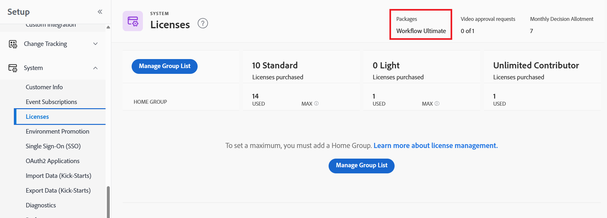

# 環境のプロモーションに関するよくある質問

環境プロモーションに関してよく質問される質問です。

## クロスドメインプロモーションはサポートされていますか？

### 回答

クロスドメイン環境のプロモーションは現在サポートされていません。 同じドメイン内の環境間で昇格する必要があります。

## Workfront インスタンスがPrimeまたはUltimate ライセンスを使用しているかどうかを確認するにはどうすればよいですか？

### 回答

* Workfront管理者は、組織のライセンスを検索できます。

  1. Workfrontの左上隅にある&#x200B;**[!UICONTROL メインメニュー]** アイコン をクリックし、**[!UICONTROL セットアップ]** をクリックします。
  1. 左側のパネルで、「**システム**」をクリックします。
  1. Workfront プランを表示するには、「**ライセンス**」を選択します。
プランがページの右上隅付近に表示されます。
     

  または
* Workfrontの担当者にお問い合わせください。

## 環境保護は双方向ですか？

### 回答

はい。 例えば、SandoxからProductionに、またはProductionからSandboxに昇格できます。

## 共有はサポートされていますか？

### 回答

いいえ、共有は現在サポートされていません。

## パッケージのロールバックは利用できますか？

### 回答

パッケージのロールバックは、最新のパッケージで、パッケージのインストールから24時間以内に利用できます。

## 個々のコンポーネントのプロモーションをスキップするオプションはありますか？ オプション `Use Existing`、`Overwrite`、`Save with a new Name`&quot;が存在する場合、個々のパラメーターのプロモーションをスキップできるように`Skip`を追加できますか？

### 回答

* 「既存のオブジェクトを使用」は、ターゲット環境の既存のオブジェクトにマッピングされ、変更を行わないため、「スキップ」またはデプロイメントを無視することと同じです。
* オブジェクトをスキップするには、プロモーションパッケージから、またはソース環境から直接インストールしないオブジェクトを削除することをお勧めします。 オブジェクトを削除した後、パッケージを再構築します。
