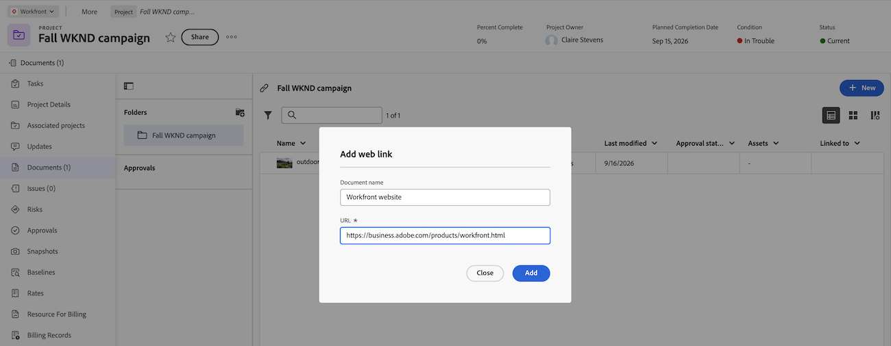

# Web リンクをドキュメントとして追加

新しいドキュメント領域からweb リンクとしてAdobe Workfrontにweb サイトを追加できます。 追加した後は、アップロードしたファイルの承認をリクエストするのと同じように、ライブ web ページで承認をリクエストできます。

組織でAdobe クラウドストレージを使用している場合、Workfrontでドキュメントにアクセスすると、新しいドキュメント エリアが表示されます。 Adobe クラウドストレージについて詳しくは、[Adobe クラウドストレージの概要](/help/quicksilver/review-and-approve-work/esm-overview.md)を参照してください。

## アクセス要件

+++ 展開すると、この記事の機能のアクセス要件が表示されます。

<table style="table-layout:auto"> 
 <col> 
 <col> 
 <tbody> 
  <tr> 
   <td role="rowheader">Adobe Workfront パッケージ</td> 
   <td> 
従来のWorkfront ストレージを使用してドキュメントを管理するWorkfront パッケージ

Adobe クラウドストレージを使用してドキュメントを管理するワークフローパッケージ
</td> 
  </tr> 
  <tr> 
   <td role="rowheader">Adobe Workfront ライセンス</td> 
   <td> 
   
コントリビューター以上
 
   
リクエスト以上
 </td> 
  </tr> 
  <tr> 
   <td role="rowheader">アクセスレベル設定</td> 
   <td> 
従来のWorkfront ストレージ：ドキュメントへのアクセスを編集する
 
   
Adobe クラウドストレージ：ドキュメントへの編集アクセスはデフォルトで有効になっており、変更できません

   </td> 
  </tr> 
 </tbody> 
</table>

詳しくは、[Workfront ドキュメントのアクセス要件](/help/quicksilver/administration-and-setup/add-users/access-levels-and-object-permissions/access-level-requirements-in-documentation.md)を参照してください。

+++

## Web リンクをドキュメントとして追加

Web リンクとしてhtml web ページをWorkfrontにアップロードできます。 追加した後は、アップロードしたファイルの承認をリクエストするのと同じように、ライブ web ページで承認をリクエストできます。 Frame.ioでのweb リンクの処理方法について詳しくは、[Frame.ioのHTML レビュー](https://support.frame.io/hc/en-us/articles/360041187574-Frame-io-Web-Links)を参照してください。

>[!IMPORTANT]
>
>* サイトでiFrameの埋め込みが許可されている場合は、URLがサポートされます。
>* プライベート web URLはサポートされていますが、サーバー設定によっては特定の認証フローが機能しない場合があります。
>* YoutubeとFigmaのURLは現在サポートされていません。 
>詳しくは、[Frame.ioでサポートされているURLの種類](https://help.frame.io/en/articles/12893213-html-review-for-frame-io#:~:text=of%20the%20page.-,What%20types%20of%20URLs%20are%20supported%3F,-URLs%20are%20supported)を参照してください。

Web リンクを追加するには：

1. Web サイトを追加するプロジェクト、タスク、またはイシューに移動し、左側のパネルで「**ドキュメント**」を選択します。
1. 「**新規**」をクリックし、「**Web リンク**」を選択します。
1. **ドキュメント名** フィールドに名前を入力し、**URL** フィールドにweb サイトのアドレスを入力します。
1. 「**追加**」をクリックします。
   

Web リンクで承認を要求するには、[&#x200B; ドキュメント承認ワークフローの作成](/help/quicksilver/review-and-approve-work/document-reviews-and-approvals/manage-document-approvals/create-a-document-approval.md)を参照してください。

## 既知の制限事項

* Frame.ioで作成されたweb リンクドキュメントに一時的な問題があります。 Frame.ioでweb リンクを作成し、そのweb リンクをWorkfrontで作成した場合、その文書はFrame.ioで開きません。 Workfrontで作成されたWeb リンクは影響を受けません。 この問題が解決するまで、承認を開始する前に、Workfrontでweb リンクドキュメントを作成します。
* 現在、Frame.ioで新しいバージョンのweb リンクドキュメントを作成することはできません。 Web リンクドキュメントの新しいバージョンを作成する必要がある場合は、Workfrontで新しいバージョンを作成します。