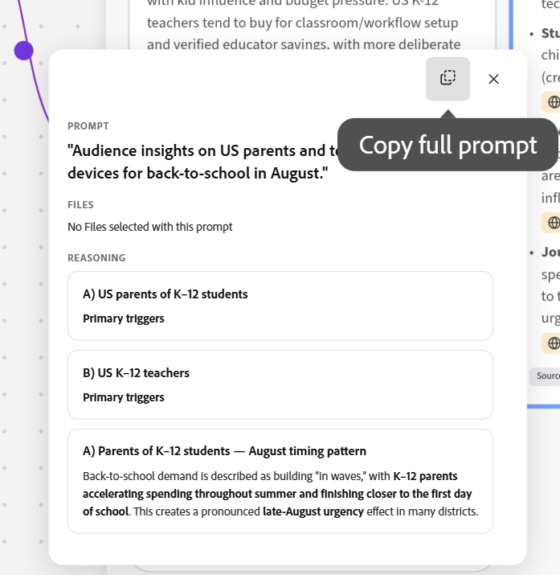

# アイデア創出スペースでブリーフを作成する

<!--add to TOC and miniTOC-->

このページの情報は、まだ一般に提供されていない機能を指します。 これは、**アイデア創出スペース Beta** プログラムの一部としてのみ使用できます。

詳細については、[Adobe Workfront Planningのアイデア創出スペースの基本を学ぶ](/help/quicksilver/planning/ideation/get-started-with-planning-ideation.md)を参照してください。

>[!IMPORTANT]
>
>この記事では、Adobe Workfront Planningを持つWorkfrontのお客様のみが使用できる機能について説明します。 会社は、追加のプランニングパッケージを購入する必要があります。
>
>ここで説明する機能は、組織がスタンドアロン製品としてWorkfront Planningを購入した場合は使用できません。
>
>Workfront計画の一般的な詳細については、[Adobe Workfront計画の基本を学ぶ](/help/quicksilver/planning/general/planning-overview.md)を参照してください。
> 
>

<!--
Future - when they make it available in Planning: replace the above with this OR ... insert the snippet:

>[!IMPORTANT]
>
>The information in this article refers to Adobe Workfront Planning which your organization can purchase either as an Adobe Workfront package or a standalone product. 
>
>Not all capabilities included in the Planning package are available to Workfront Planning when it is purchased as a standalone product. 
>
>For general information about Workfront Planning, see [Get started with Adobe Workfront Planning](/help/quicksilver/planning/general/planning-overview.md).
> 
>For information about Workfront Planning as a standalone product, see [Get started with Adobe Workfront Planning as a standalone product](/help/quicksilver/planning/planning-sta/planning-sta-overview.md). 
>
-->

Adobe Workfront Planningの新しい機能であるアイデア創出スペースを使用すると、ブリーフをプランニングレコードに変換したり、外部ファイルとして保存したりできます。 書き出されたブリーフは、新しいレコードを作成したり、既存のレコードを更新したりできます。

この記事では、アイデア創出スペースでブレインストーミングを行い、戦略を練ってブリーフを作成する方法について説明します。

次の操作を実行できます。

* レコードを作成または更新するには、完成したアイデア出し概要をWorkfront Planningに書き出します。

* 別のアプリケーションで概要の情報を使用するには、次のいずれかのファイル形式に書き出します。

  * PDF
  * 単語
  * PowerPoint
  * PowerPoint テンプレート

## アクセス要件

+++ 展開して、この記事の機能のアクセス要件を表示します。 

<!--
are there additional license restrictions or packages to be purchased to have access to Ideation space?? If yes, update the table below
-->

<table style="table-layout:auto"> 
<col> 
</col> 
<col> 
</col> 
<tbody> 
    <tr> 
<tr> 
</tr> 
<tr> 
   <td role="rowheader">
クラウドプロバイダーの要件
</td> 
   <td>
Amazon Web Services（AWS）

   
<b>メモ：</b>

   
他のクラウドプロバイダーはサポートしていません。

   </td> 
  </tr>
<tr> 
   <td role="rowheader">
Adobe Workfront パッケージ
</td> 
   <td> 
<ul> 
<li>
プランニングパッケージを含むあらゆるワークフロー
</li>
<!--
Add this at GA - not available in beta:
Or
<li>
Any Planning package when purchased as a standalone product
</li>
-->
</ul>
   </td> 
<!--
<tr> 
<td role="rowheader">
Additional products
</td> 
<td><ul>
<li>
Adobe GenStudio for Performance Marketing
</li>
<li>
Adobe Customer Journey Analytics
</li>
</ul>
</td> 
</tr> 
-->
<tr> 
   <td role="rowheader">
必要システム構成
</td> 
   <td>
設定エリアのシステム環境設定の同僚とMCP環境設定をオンにする必要があります

   </td> 
  </tr> 
  <tr> 
   <td role="rowheader">
Adobe Workflow ライセンス
</td> 
   <td>
標準

   </td> 
  </tr> 
<tr> 
   <td role="rowheader">
Adobe計画ライセンス
</td> 
   <td>
標準

   </td> 
  </tr>  
<tr> 
   <td role="rowheader">
アクセスレベルの設定
</td> 
   <td> 
   <ul>
   <li>
アクセス レベルには、ワークフローとプランニング ライセンス タイプの両方を追加する必要があります <!--when you have both a Workflow and a Planning package-->
   </li>
   <li>
アクセスレベルの「アイデア創出スペースを無効にする」設定を選択解除する必要があります
</li>
   <li>
アクセスレベルの「WorkfrontでCX Coworker パネルを無効にする」設定を選択解除する必要があります
</li></ul>
</td> 
  </tr>  
   <tr> 
   <td role="rowheader">
オブジェクト権限
</td> 
   <td> 
レコードを追加するワークスペースおよびレコードタイプに対する権限を設定します 

      
システム管理者は、作成しなかったワークスペースも含め、すべてのワークスペースに対する権限を持っています。

      <!--
      not available right now:
      
View permissions to Workfront objects to add them to briefs 

      -->
      
ブリーフを作成するためのアイデア創出スペースの編集者権限

   </td> 
  </tr>  
    <!--
    <tr> 
    <td role="rowheader">
Adobe GenStudio for Performance Marketing user roles
</td> 
    <td>
<ul><li>Any GenStudio user role to access Campaigns, Products, and Personas</li>
    <li>GenStudio System Manager to access Activations and Events</li></ul>
    For information, see <a href="https://experienceleague.adobe.com/en/docs/genstudio-for-performance-marketing/user-guide/intro/user-roles">User roles and permissions</a>. 
    

    </td> 
    </tr> 
    -->
</tbody> 
</table>

Workfrontのアクセス要件について詳しくは、[Workfront ドキュメント &#x200B;](/help/quicksilver/administration-and-setup/add-users/access-levels-and-object-permissions/access-level-requirements-in-documentation.md)のアクセス要件を参照してください。

+++  

## アイデア創出スペースブリーフの作成

ブリーフを作成して、プランニングレコードを作成または編集したり、他のアプリケーションに書き出すことができるファイルを作成したりできます。

1. 共同作業者がオンになっているPlanningでWorkfrontにログインし、次のいずれかの操作を行ってアイデア創出スペースを初めて開き、ブリーフを作成します。

   * **メインメニュー**  > **アイデア創出スペース**&#x200B;に移動します
   * **メインメニュー**  > **計画** > ワークスペースをクリック > レコードタイプをクリック > **新しいレコード** > **アイデア創出スペースを開始**&#x200B;に移動

1. ベータ版の契約書を読み、**同意**&#x200B;をクリックします。 アイデア創出スペースを使用するには、契約書に署名する必要があります。

   アイデア立案スペース キャンバスが開き、新しいアイデアがデフォルトで次の形式の後にタイトル付けされます。

   `catalyze-canvas-< number > - Month date, year at time` <!--submitted bug to change the default name to "Untitled ideation"-->

   アイデア創出スペースを使用してレコードを作成する方法の詳細については、[&#x200B; アイデア創出スペースの概要から計画レコードを作成](/help/quicksilver/planning/ideation/create-records-in-ideation-space-for-planning.md)を参照してください。

1. （条件付き）アイデア創出スペースで既存の概要を開くには、共同作業者がオンになっているPlanningでWorkfrontにログインし、次のいずれかの操作を行います。

   * **メインメニュー**  > **計画**&#x200B;に移動> ワークスペースをクリック > レコードタイプをクリック >既存のレコードをクリック > **アイデア創出スペースで開く**

     アイデアの名前は、レコードの名前と一致します。

1. （推奨）初めて開いた場合は、アイデアの名前をクリックして名前を変更します。

1. （条件付き、オプション）別の既存のアイデア スペースを開くには、アイデア名の右側にあるドロップダウンメニューをクリックし、名前で検索して、リストにアイデアが表示されたらアイデアをクリックします。

   **アイデア創出スペース**&#x200B;が開き、右側に共同作業者が開きます。
1. 共同作業者プロンプトを使用して、作成する概要の種類を説明します。

   例えば、「米国の保護者と教師のために、8月の月を通して実行する小中高校向けの新学期キャンペーンを作成する」と入力します。  ブリーフを完成させるには、どのようなキャンペーン、タイムライン、関係者、承認のチェックポイントなど、利用可能な情報をできるだけ多く示してください。
1. （オプション）同僚プロンプトボックスの&#x200B;**+** アイコンをクリックし、次の方法で情報を添付します。

   * **コマンド**: リストのコマンドを使用して、Coworkerにコンテンツを要求します。
   * **ファイルを添付**: プロンプトボックスにファイルを添付して、そのファイルまたは情報をアイデア出しキャンバスに追加します。 後でカードをブリーフに送信するには、Coworkerにファイルに基づくカードの作成を依頼する必要があります。
   * **オブジェクトを参照**：リストからオブジェクトを選択して、アイデアの中でオブジェクトを参照します。 オブジェクトはWorkfrontに存在する必要があります。

1. 「Enter」をクリックします。

1. 同僚からの質問に答えてアイデア出しを続行し、**送信**&#x200B;をクリックします

   または

   「**アンケートをスキップ**」をクリックして、追加の質問をスキップします。

1. （条件付き）共同作業者がアイデアのカードを作成するオファーを提供する場合は、**はい**&#x200B;と回答します。

   アイデア創出キャンバスにカードが追加され、各カードのソースを確認して、ブリーフに追加するカードを決定できます。

   >[!TIP]
   >
   >概要にファイルを直接追加することはできません。 最初に、ファイル情報をカードに転送して、ブリーフに送信する必要があります。

1. **検索** アイコン をクリックして、アイデア創出キャンバス内のアイテムを検索し、リストに表示されたらクリックしてリストに移動します。

1. （オプション）各カードの下部にある「**ソース**」をクリックして、情報の収集元を確認します。

   Workfront PlanningまたはWebから情報をインポートできます。

   スペースの右上隅にある&#x200B;**ソース** アイコン をクリックして、スペース内のすべてのカードのソースのリストを表示することもできます。
1. （オプション）スペースの右上隅にある&#x200B;**コメント** をクリックし、他のユーザーに&#x200B;**@** タグを付けて、スペース内でブレインストーミングを開始します。

   ユーザーには、タグに関する通知メールが送信されます。
1. （オプション）コメントカード内の&#x200B;**フィルター** アイコン をクリックして、次の条件でコメントをフィルタリングします。

   * レビュー担当者
   * コメントが追加された時間
   * ステータス（コメントが解決された箇所、または未解決の箇所）
   * 未読（未読コメントのみを表示）
1. （オプション）カードの&#x200B;**親指の上下**&#x200B;または&#x200B;**親指の下下** アイコンを使用して、カードの情報の正確性に関するフィードバックを提供します。
1. カードをクリックするか、すべてのカードを含むフレームをクリックし、**概要に追加**&#x200B;をクリックして、情報を概要に追加します。

   Workfrontは、各情報と、データを保存する可能性が最も高いフィールドを一致させます。

   例えば、タイムラインは日付型フィールドに追加され、説明は段落型フィールドに追加されます。

1. （条件付き）カードをクリックし、「**AIに質問…**」をクリックして、情報を概要に追加する前に、次のステップのアイデアを得ます。 答えは、各カードの情報のコンテキストにあります。
1. アイデア出しキャンバスの左上隅にある「**ドキュメントを追加**」アイコン「」をクリックして、スペースにドキュメントをアップロードします。 以前にスペースに追加した新しいドキュメントまたはドキュメントを追加できます。

   >[!TIP]
   >
   >ドキュメントにアクセスしてスペースにアップロードするには、「ドキュメント」設定をオンにする必要があります。
   >詳しくは、この記事の「[&#x200B; アイデア創出スペース キャンバスの設定](#configure-the-ideation-space-canvas)」の節を参照してください。
   > 
1. **Workfront接続計画レコードを追加** アイコン をクリックして、接続されたレコードタイプを選択し、各タイプからレコードを選択して、選択したレコードタイプにそのレコードの情報を追加します。

   スペースに追加するために選択したレコードのカードが作成されます。 レコードタイプは、レコードのカードの左上隅に表示されます。

   >[!TIP]
   >
   >* メインメニューからアイデア創出スペースにアクセスし、概要が計画レコードに接続されていない場合、**Workfront接続計画レコードを追加** アイコンは使用できません。
   >
   >* 接続されたプランニングレコードのみが、アイデア創出のコンテキストとしてアイデア創出スペースキャンバスに追加できます。 カンバスに追加される接続された各レコードカードは、作成されたコンテンツのタイプに影響を与え、アイデアの策定中に該当する場合はそのコンテキストを使用します。
   >
   >   例えば、既存のレコードタイプを活用する必要があるキャンペーンを作成する場合は、それらのレコードをキャンバスに追加します。

1. （オプション）接続されているレコードカードの&#x200B;**詳細** メニューをクリックし、**Workfrontで表示**&#x200B;をクリックします。

   レコードの詳細ページが、Workfront Planningの別のブラウザータブで開きます。
1. （オプション）アイデア創出フレームまたはカードを選択し、**削除** アイコンをクリックしてから、**削除**&#x200B;をクリックして確定します。 カードがアイデア出しスペース キャンバスから削除されます。

   保存されたドキュメントまたはレコードに対応するカードを削除すると、アイテムはキャンバスから削除されますが、それぞれのアプリケーションに残ります。

1. （オプション）いつでも右下隅の「**同僚に質問**」ボックスを使用して、アイデアを絞り込みます。

   例えば、特定のカードに対して`regenerate`と入力すると、更新されたコンテキストを使用してそのカードをやり直すことができます。 アイデア創出スペースは、推論ステップ（検索、合成、引用）を再実行し、影響を受けるカードを更新します。

1. （オプション）任意のアイデア カード セットから紫色のコネクタのいずれかをクリックし、**完全なプロンプトをコピー** アイコンをクリックして、カードを生成したプロンプトをクリップボードにコピーし、Coworker プロンプト ボックスに貼り付けます。

   

1. （オプション）キャンバスの上部にある「**取り消し**」または「**やり直し**」アイコン「」をクリックして、アクションをキャンセルまたは取り消します。
1. 元のキャンペーン目標、AIが生成した引用を含むあらゆるコンセプトカード、追加のドキュメント、取り込んだ実際のWorkfrontプランニングレコード（商品、ペルソナなど）の全体像を確認できます。 左下隅の&#x200B;**概要**&#x200B;概要カードを使用すると、すべての概要をまとめて表示できます。

1. 左下隅にある概要プレビュー画像をクリックして概要を確認し、次のいずれかのオプションをクリックします。

   * **ファイルにエクスポート**。 ブリーフは、次のファイルタイプに書き出すことができます。

     * PDF
     * 単語
     * PowerPoint （テンプレートの有無にかかわらず）
   * **Workfront Planningに書き出し**。 書き出しでは、アイデア出しに対応するプランニングレコード内の既存のフィールドデータがすべて上書きされます。

   >[!TIP]
   >
   >メインメニューからアイデア創出スペースにアクセスし、概要が計画レコードに接続されていない場合、**Workfront計画**&#x200B;への書き出しはグレー表示になります。

   これにより、レコードまたは追加情報を含むファイルの作成が完了します。 既存のレコードから開始した場合、概要の情報がレコードに追加されます。 新しいレコードで開始した場合は、ブリーフの情報を使用してレコードが作成されます。

   ブリーフを使用してプランニングレコードを更新する方法について詳しくは、記事[&#x200B; アイデア出しスペースブリーフからプランニングレコードを作成](/help/quicksilver/planning/ideation/create-records-in-ideation-space-for-planning.md)の「アイデア出しスペースを使用してレコードを作成する場合の考慮事項」の節を参照してください。
1. （オプション）「**共有**」をクリックして、アイデア出しキャンバスを他のユーザーと共有します。

   詳しくは、「[&#x200B; アイデア創出スペースを他のユーザーと共有する](/help/quicksilver/planning/ideation/share-the-ideation-space.md)」を参照してください。

## アイデア立案スペースキャンバスの設定

アイデア創出スペースには、画面に表示される内容を設定したり、カンバスを操作したりするためのコントロールがあります。

1. **Settings** アイコン をクリックして、AIが情報を取得する場所を制御し、次の&#x200B;**Sourceの種類**&#x200B;から選択します。

   * **ドキュメント** – 選択したスペースにドキュメントをアップロードしました
   * **Web Search** – 外部web リサーチ
   <!--
     **CJA** — Adobe Customer Journey Analytics
    -->
1. 「**保存**」をクリックします。

1. **ヘルプ** アイコン の左側にある&#x200B;**ズームレベル** ドロップダウンメニューをクリックして、オプションを選択します。

   次のオプションから選択します。

   * **全体表示**
   * **ズームイン**
   * **ズームアウト**
   * **50**、**100**、**150**&#x200B;または&#x200B;**200%**&#x200B;にズームします
   * **ドットグリッドを表示**：選択範囲をオンにしてドットグリッドを表示します。
   * **製品ツアー**：アイデア創出スペースの使用中にガイドのヒントをオプトアウトするには、選択範囲をオフにします。

1. **ヘルプ** アイコン をクリックして、キャンバスのナビゲーションまたは別のズーム値の選択に使用できるキーボードショートカットを確認します。

| アクション | ショートカット |
| --- | --- |
| ズームイン/ズームアウト | Ctrl/⌘ + / − |
| 100%にズーム / | Ctrl/⌘ 1 / 1 |
| 200%にズーム / | Ctrl/⌘ 2 / 2 |
| 全体表示 | Ctrl/⌘ 0 / 0 |
| 選択範囲に合わせてズーム | Alt Ctrl 0 |
| カーソルにズーム | Ctrl/⌘ スクロール |
| パン | スペースを押しながらドラッグ |
| ドットグリッドを表示・非表示 | G |

<!--

    Once opened, the Ideation space agent goes through the following steps:

    1. **Data ingestion and synthesis**:  Pulls relevant information from connected sources. For example: 
    
        * Existing record types or the existing record type that you started from. 
        * Recent documents you might have uploaded in the ideation space. 
        * Web information that matches your prompt criteria.

            >[!TIP]
            >
            >The Web search setting must be turned on for AI to be able to look for information on the web.  
            >For information, see the section [Configure the Ideation space](#configure-the-ideation-space)in this article.
            >
    1. **Audience definition**: Identifies or recommends target audience parameters based on historical patterns
    1. **Strategy framing**: Structures the strategic narrative for the campaign
    1. **Messaging and concept ideation**: Generates initial message options and creative concept directions
    1. **Brief generation and planning handoff**: Produces a structured brief that feeds back into the Workfront Planning workspace

        When the Ideation agent finishes the process of collecting all the information, the following things occur: 
    
        * Five cards are created and are organized by relevant and like-information. 

            The cards are titled using various steps in the creation of the requested record, for easy recognition. 
    
            For example, they could be named:

            * Plan
            * Timeline
            * Segments
            * Mechanics  
            * Messaging 

        The cards titles are custom to each card in the ideation. 

        * The cards are placed inside the same frame indicating this is the result of one ideation. 

        * A brief is created and displays in a preview image in the lower-left corner of the Ideation space. <!
    
        The brief contains suggested fields that the system considers pertinent to the ideas you are exploring. 
-->

