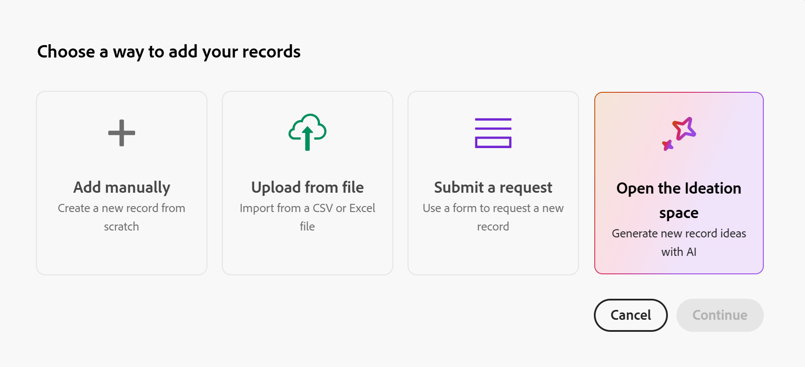
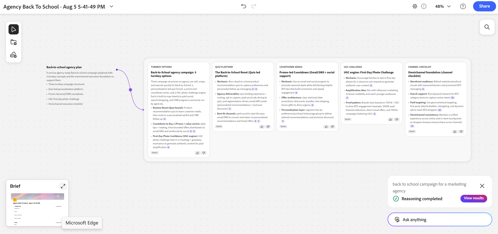

# アイデア立案スペースの概要からプランニングレコードを作成または編集

<!--
Will this release JUST to preview? If not - hide the preview portion below
-->

<!--
I started with this under Records first but what if Ideation will be added to other products and it will generate record types in those products? keep it here so it can be moved, if needed, to a standalone product one day?
-->

<!--
*********************** IMPORTANT ***************
THIS ARTICLE HAS 2 DRAFTS IN 2 SEPARATE AREAS FROM CLAUDE - THEY WERE CREATED AT DIFFERENT TIMES - WHICH ONE WOULD YOU KEEP OR MERGE THEM INTO ONE ARTICLE
-->

このページの情報は、まだ一般に提供されていない機能を指します。 これは、**アイデア創出スペース Beta** プログラムの一部としてのみ使用できます。

詳細については、[Adobe Workfront Planningのアイデア創出スペースの基本を学ぶ](/help/quicksilver/planning/ideation/get-started-with-planning-ideation.md)を参照してください。

{{planning-important-intro}}

Adobe Workfront Planningの新しい機能であるアイデア創出スペースを使用すると、ブリーフをプランニングレコードに変換できます。 書き出されたブリーフは、新しいレコードを作成したり、既存のレコードを更新したりできます。

この記事では、アイデア創出スペースを使用して、既存のプランニングレコードを作成または編集する方法について説明します。

## アクセス要件

+++ 展開して、この記事の機能のアクセス要件を表示します。 

<!--
are there additional license restrictions or packages to be purchased to have access to Ideation space?? If yes, update the table below
-->

<table style="table-layout:auto"> 
<col> 
</col> 
<col> 
</col> 
<tbody> 
    <tr> 
<tr> 
</tr>   
<tr> 
   <td role="rowheader">
Adobe Workfront パッケージ
</td> 
   <td> 
<ul> 
<li>
プランニングパッケージを含む任意のWorkfrontまたはワークフロー
</li>
<!--
Not available for beta:
Or
<li>
Any Planning package when purchased as a standalone product
</li>
-->
</ul>
   </td> 
    <!--
    <tr> 
    <td role="rowheader">
Additional products
</td> 
    <td><ul>
    <li>
Adobe GenStudio for Performance Marketing
</li>
    <li>
Adobe Customer Journey Analytics
</li>
    </ul>
    </td> 
    </tr> 
    -->
  <tr> 
   <td role="rowheader">
Adobe Workflow ライセンス
</td> 
   <td>
標準

   </td> 
  </tr> 
<tr> 
   <td role="rowheader">
Adobe計画ライセンス
</td> 
   <td>
標準

   </td> 
  </tr> 
<tr> 
   <td role="rowheader">
アクセスレベルの設定
</td> 
   <td> 
   <ul>
   <li>
ワークフローとPlanning パッケージの両方を持っている場合は、ワークフローとPlanning ライセンスタイプの両方をアクセスレベルに追加する必要があります
   </li>
   <li>
アクセスレベルの「アイデア創出スペースを無効にする」設定を選択解除する必要があります
</li>
</td> 
  </tr>  
   <tr> 
   <td role="rowheader">
オブジェクト権限
</td> 
   <td> 
レコードを追加するワークスペースおよびレコードタイプに対する権限を設定します 

      
システム管理者は、作成しなかったワークスペースも含め、すべてのワークスペースに対する権限を持っています。

      
Workfront オブジェクトに対する権限を表示して、ブリーフに追加する <!--not sure if this is available-->

      
ブリーフを作成するためのアイデア創出スペースの編集者権限

   </td> 
  </tr>  
    <!--
    <tr> 
    <td role="rowheader">
Adobe GenStudio for Performance Marketing user roles
</td> 
    <td>
<ul><li>Any GenStudio user role to access Campaigns, Products, and Personas</li>
    <li>GenStudio System Manager to access Activations and Events</li></ul>
    For information, see <a href="https://experienceleague.adobe.com/en/docs/genstudio-for-performance-marketing/user-guide/intro/user-roles">User roles and permissions</a>. 
    

    </td> 
    </tr> 
    -->
</tbody> 
</table>

Workfrontのアクセス要件について詳しくは、[Workfront ドキュメント &#x200B;](/help/quicksilver/administration-and-setup/add-users/access-levels-and-object-permissions/access-level-requirements-in-documentation.md)のアクセス要件を参照してください。

+++   

## アイデア立案スペースを使用してプランニングレコードを作成または編集する場合の考慮事項

* プランニングレコードを作成または編集するには、Workfront計画からアイデア創出スペースを起動する必要があります。 Workfrontのメインメニューからアイデア創出スペースにアクセスしても、アイデア創出の概要がプランニングレコードに関連付けられることはありません。
* アイデア創出スペースを使用してレコードを作成または編集するには、Workfront Planningにワークスペースとレコードタイプが必要です。
* 新しいレコードは、作成方法に関係なく、常にプレースホルダーコンテンツから開始されます。
* アイデアの概要にリンクされているプランニングレコードを削除すると、アイデアの概要はアイデアのスペースに残り、関連するスペースは削除されません。
* 情報の同期は、アイデア立案スペースからWorkfront Planningにのみ行われます。 プランニングレコードからアイデア創出スペースブリーフへの逆同期や自動同期はありません。<!--this might change?-->
* Workfront Planningでフィールドを作成、編集または削除する場合、次のシナリオが存在します。

  * アイデア立案ブリーフにリンクされたレコードに作成された新しいフィールドは、毎日ブリーフに追加されます。 新しいフィールドは、アイデアの概要では空で表示されます。
  * 削除されたフィールドはブリーフに残り、以前の値を保持します。
  * 名前を変更したフィールドは、ブリーフ内の名前を更新します。
* アイデア出しスペースでは、ドキュメントをカードとして追加できます。 これには画像も含まれます。

  PDF、Excel、CSV、PNG （およびその他の画像形式）、Word、PowerPointなどのファイル形式を追加できます。 ビデオはサポートされていません。

  アップロードされたすべてのドキュメントは、バックエンドのPDFに変換され、処理されます。
* レコードをWorkfront Planningから直接スペースにドラッグ&amp;ドロップすることができ、手動でアップロードしたファイルと同じように表示されます。

## アイデア創出スペースを使用したレコードの作成

1. Workfront Planningのランディングページで、管理できるワークスペースのカードをクリックします。
1. レコードを追加できるレコードタイプのカードをクリックします。
1. レコードを作成するには、次のいずれかの操作を行います。

   * レコードタイプページの任意のビューで、ページの右上隅にある&#x200B;**新しいレコード**&#x200B;をクリックし、**レコードを追加する方法を選択** ボックスで、**アイデア創出スペースを開く**&#x200B;をクリックし、**続行**&#x200B;をクリックします。
   * レコードテーブルの一番下までスクロールして&#x200B;**新しい行**&#x200B;をクリックし、**アイデア創出スペースを開く**&#x200B;をクリックします。

     >[!TIP]
     >
     >「**表示しない**」を選択すると、今後のプロンプトが完全に閉じられます。 閉じるアイコン **X**&#x200B;をクリックすると、このボックスは閉じますが、次回レコードをインラインに追加すると再度表示されます。

   

   アイデア創出スペースが新しいタブで開きます。

   右側のパネルにCX Coworkerが開きます。

   レコードはすぐにプレースホルダー名で作成されます。

   <!--
    1. (Optional) Click the **Open previous canvases** icon  in the upper-right corner of the prompt box, to open existing briefs
    -->

1. **CX Coworker** ダイアログボックスにプロンプトを追加し、Enter キーを押します。

   共有する詳細情報が多ければ多いほど、アイデア創出スペースから提供される情報がより有用になります。 例えば、計画しているキャンペーンの説明を「マーケティングエージェンシーの学校戻りキャンペーン」と入力します。

1. 記事[&#x200B; アイデア創出スペースでブリーフを作成](/help/quicksilver/planning/ideation/create-briefs-in-ideation-space.md)の説明に従って、アイデア創出ブリーフの作成を続行します。

   <!--
    1. Click **Start ideating**.
        The Ideation space works through the following steps while it builds your idea: 
        1. Understand your goal and context
        2. Review your space and selected materials
        3. Gather evidence from documents, web, and data
        4. Synthesize findings into a research summary
        5. Create and refine cards with citations
        During this process you'll see the Ideation space actively searching connected Workfront Planning data or information available on the web.
        For example, it might search for existing programs, products, personas, or regions, as well as for similar concepts available online. 
        When the ideation completes, the following things are added to the Ideation space:  
        * A summary of the AI findings which is linked to several cards with detailed information about things to consider. The details cards display in a new section. A connector indicates which card section belongs to which summary.  
        * A **Brief** file in the lower-left corner of the ideation space. The brief is a draft of the future record and it displays as a record's Details page. 
              
    1. Continue to add information to the ideation space to complete creating your brief. 
    -->

1. （条件付き）概要が完了したら、左下隅にあるプレビュー画像をクリックし、**Workfront計画に書き出し**&#x200B;をクリックして、計画レコードを作成します。

   これにより、追加情報を含むレコードの作成が完了し、最初に選択したレコードタイプに追加されます。

## アイデア立案スペースを使用した既存レコードの編集

既存のレコードからアイデア創出スペースを開いて更新できます。

アイデア出しスペースでレコードを一括編集することはできません。

1. Workfront Planningの既存のレコードに移動し、その詳細ページを開きます。

1. 「**アイデア創出スペースで開く** 」をクリックします。 これにより、新しいタブでアイデア創出スペースが開きます。

   レコードのアイデアが既に存在する場合、そのスペースが開きます。

   アイデアが存在しない場合は、アイデア創出スペースと概要を作成します。

   >[!TIP]
   >
   >アイデア出しスペースを使用してレコードを一括編集することはできません。
1. この記事の「[&#x200B; アイデア創出スペース &#x200B;](#create-records-using-the-ideation-space)」の節で説明しているように、引き続き概要を編集します。

   <!-- 
    I don't think these steps are still valid but the environment was not available to test: 
    - If a record is already linked to a Catalyze canvas, a link appears beneath the record title; clicking it opens the associated canvas.
    - If a linked canvas hasn't been exported/pushed back yet, the record shows a placeholder message ("This record has active Canvas...") even if the canvas itself has a real name in Catalyze.
    -->

<!--
this is from Claude, but rephrased and included most of this above: 

## Step 5: Open the Workfront Planning Records panel

To bring real Workfront Planning records into your canvas (rather than just AI-generated ideas), click the **records icon** in the left-hand toolbar (third icon down). This opens the **Workfront Planning Records** panel, listing all **Connected Record types** available in your Planning environment — for example:

- Products
- Regions
- Personas
- Channels
- Activations
- Project
- Test Record
- Experience Manager Assets

## Step 6: Drag real records onto the canvas

Search or browse within a record type (e.g., **Products** or **Personas**), then drag the record you want directly onto the canvas. In the example, an existing **Nike product** record and a **Deep testing** persona record were both dragged in and positioned near the relevant concept cards.

This lets you visually connect your AI-generated ideas to the actual records that already exist in Workfront Planning, grounding the ideation in real data rather than hypothetical entities.

---

## Step 7: Refine with follow-up prompts

Use the **Ask anything** box in the bottom-right corner at any time to refine the canvas — for example, typing `regenerate` against a specific card to have Catalyze redo that section using updated context. Catalyze will re-run its reasoning steps (searching, synthesizing, citing) and update the affected cards in place.

---

## Step 8: Review the full canvas

Zoom out to see the complete picture: your original campaign goal, all AI-generated concept cards with citations, the real Workfront Planning records you've pulled in (Products, Personas, etc.), and a **Campaign Brief** summary card in the corner pulling it all together.

---

## Tips

- **Be specific in Step 2** — richer campaign descriptions produce more relevant, better-grounded cards.
- **Check citations** before trusting a generated fact — click **Sources** on any card.
- **Mix AI cards with real records** — dragging in actual Products, Personas, Regions, etc. keeps the canvas tied to your real Planning data, not just AI speculation.
- Responses are AI-generated and may be inaccurate — always verify against the linked sources before finalizing a record.

***************SECOND DRAFT FROM CLAUDE*******************
# Creating and Managing Records with Catalyze Ideation

> This workflow reflects the Closed Beta experience and is expected to evolve before Open Beta and GA. Confirm current behavior before publishing to customers.

This guide explains how to create and ideate on records using Catalyze within Workfront Planning. It covers all entry points, system behavior, data sync rules, and file-upload support.

## Before you start

- You must have access to a record list within Workfront Planning.
- Catalyze always opens in a **new browser tab** — this is consistent across every entry point.
- Any record created through Catalyze starts with **placeholder text** until you begin ideating.

## Option 1: Create a record via the top-level "New Record" button

1. Navigate to your record list in Workfront Planning.
2. Click the **New Record** button at the top of the page.
3. From the dropdown menu, select **Ideate in Catalyze**.
4. A new browser tab opens automatically, launching the Catalyze canvas.
5. A new record is created in Workfront Planning with placeholder text.
6. Begin ideation directly in Catalyze.

**Additional access from the record view:** Open the newly created record and, in its detail modal, click **Ideate in Catalyze**. This opens Catalyze in a new tab (same behavior as above).

## Option 2: Create a record via inline record creation (bottom of table)

1. Scroll to the bottom of the record table.
2. Click **New Record**.
3. The record is created immediately with placeholder text.
4. A pop-up appears with these options:
   - **Open Catalyze** — launches Catalyze in a new browser tab
   - **Don't Show Again** — permanently dismisses the future prompt
   - **X (Close)** — closes the pop-up; it will reappear next time
5. Click **Open Catalyze** to begin ideation.

## Working with existing records

**Contextual actions (bottom selection bar)**
- **Single record selected:** an "Ideate in Canvas" / "Open in Canvas" action appears.
  - If a canvas already exists, it opens that canvas.
  - If no canvas exists, it creates a new one.
- **Multiple records selected:** the Ideate/Open in Canvas action is **not available** — bulk ideation is not supported.

**Record detail panel**
- If no canvas is connected, an **Ideate in Catalyze** button appears in the record header.
- If a record is already linked to a Catalyze canvas, a link appears beneath the record title; clicking it opens the associated canvas.
- If a linked canvas hasn't been exported/pushed back yet, the record shows a placeholder message ("This record has active Canvas...") even if the canvas itself has a real name in Catalyze.

**When can you create a canvas for a record?**
A canvas can be created for a record that is in Workfront Planning and still in **draft** state (not yet marked "ready").

## Record deletion behavior

If a Planning record linked to a Catalyze canvas is deleted:
- The canvas remains intact in Catalyze.
- No data is removed from Catalyze.

## Data synchronization rules

**Sync direction:** One-way only, from Catalyze → Workfront Planning. There is no reverse or automatic sync from Planning back to Catalyze.

**Export process:**
1. In Catalyze, click **Export to Planning**.
2. Data is pushed to the connected Workfront Planning record.
3. The export **overwrites all existing field data** in the record.

**Important notes:**
- Changes made directly in Workfront Planning do **not** sync back to Catalyze.
- Data refresh in Workfront Planning is manual only (Beta behavior) — there is no scheduled/automatic sync.
- Schema updates do sync one direction: once connected, Planning schema changes propagate to Catalyze daily — added fields appear empty, removed fields keep their prior values, and renamed fields update in place.

## Uploading documents into the Catalyze canvas

- Files can be added as a "document card" on the canvas — this works the same whether the file is an image or another document type.
- You can drag and drop files directly from Workfront Planning onto the canvas, and they appear the same way as manually uploaded files.
- All uploaded documents are converted to PDF on the backend for processing.
- Supported file types (as of the Aug 2026 beta): **PDF, Excel, CSV, PNG (and likely other image formats), Word, PowerPoint.**
- **Not supported:** video files.
- You can include images directly in a prompt and Catalyze will recognize their content, though small-format legibility is still being refined.

## Key takeaways

- Use **Ideate in Catalyze** to connect records to the AI-assisted ideation workflow.
- Catalyze always launches in a separate browser tab.
- New records always start with placeholder content, regardless of entry point.
- Data flow between Catalyze and Planning is manual and one-directional (Catalyze → Planning).
- Deleting a Planning record does not delete its associated Catalyze canvas.

-->

<!--
Internal info: 

## The Ideation space and Adobe GenStudio

Adobe GenStudio for Performance Marketing is Adobe's end-to-end content supply chain solution, spanning five stages:

1. Strategy and Ideation
2. Workflow and Planning
3. Asset Management
4. Creation and Production
5. Delivery and Activation

The Ideation space fits in the **Strategy and Ideation** stage — the front door of the content supply chain — and is designed to work natively with the rest of GenStudio, so the briefs and strategic direction it generates flow directly into Workfront Planning for execution.
-->

