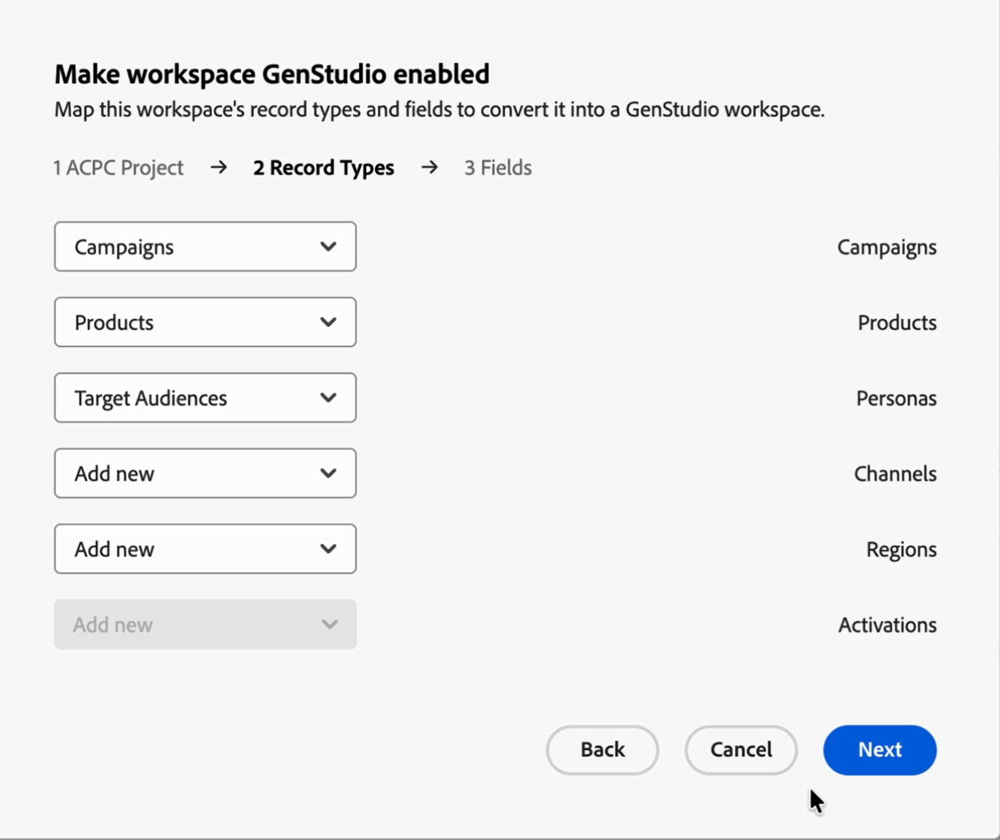

# GenStudio for Performance Marketingに対するWorkfront計画ワークスペースの有効化

{{planning-important-intro}}

<!-- THIS IS HIDDEN FROM TOC-->

<!--
Better metadata, at publishing:
---
title: Promote a Workfront Planning workspace to GenStudio
description: The GenStudio for Performance Marketing workspace is available in Adobe Workfront Planning when your company has purchased both products and your instance of Workfront is integrated with your company's instance of GenStudio. You can promote a Workfront Planning workspace to GenStudio and have its information visible and updated from both systems.
role: User, Admin
author: Alina
recommendations: noDisplay, noCatalog
---
-->
Workfrontプランニングに加えて、Adobe GenStudio for Performance Marketingも購入した場合、Workfrontのインスタンスが自社のGenStudioのインスタンスと統合されている場合、GenStudio WorkspaceはAdobe Workfront Planningで利用できます。

Workfront Planningに既にワークスペースがある場合は、データを再作成する代わりにGenStudioに対してワークスペースを有効にできます。

ワークスペースを有効にすると、そのワークスペースがAdobe ストレージプロジェクトにリンクされ、そのレコードタイプとフィールドがGenStudio ワークスペーススキーマにマッピングされます。 設定が完了したら、GenStudioでワークスペースのレコードを開くことができます。

次の点に注意してください。

* Workfront PlanningとGenStudio for Performance Marketingの両方にアクセスできる必要があります。
* ワークスペースにリンクするには、Adobe クラウドストレージプロジェクトが必要です。 組織管理者は、Adobe Admin Consoleで組織管理者を作成できます。

  詳しくは、[Adobe ストレージの管理](https://helpx.adobe.com/business/enterprise/manage-storage-assets/manage-storage/manage-adobe-storage.html)を参照してください。<!--ensure this site still works-->

## GenStudioに対するWorkfront計画ワークスペースの有効化

1. Workfront Planningで、有効にするワークスペースを開きます。
1. ワークスペース名の右側にある&#x200B;**詳細** メニューをクリックし、「**GenStudioを有効にする**」をクリックします。

   「**ワークスペースをGenStudio**&#x200B;有効にする」ボックスが開き、次の手順を実行します。

   1. **ACPC プロジェクト**：このワークスペースと同期する&#x200B;**ACPC プロジェクト** （Adobe クラウドストレージプロジェクト）を選択し、**次へ**&#x200B;をクリックします。 ユーザーは、このプロジェクトを通じてGenStudioのワークスペースにアクセスします。

      

   1. **レコードタイプ**: ワークスペースのレコードタイプを、GenStudioで必要な6つのレコードタイプにマッピングします。

      * キャンペーン
      * 製品
      * ペルソナ
      * チャネル
      * 地域
      * アクティベーション

      それぞれに対して、リストを開いて、一致するプランニング レコード タイプを選択するか、**新しい**&#x200B;を追加を選択して作成し、**次へ**&#x200B;をクリックします。

      

   1. **フィールド**：各レコードタイプのフィールドをマッピングします。 ダイアログの上部にあるタブを使用して、レコードタイプ間を移動します。 各フィールドについて、一致する計画フィールドを選択するか、**新規追加**&#x200B;を選択して作成します。

      すべてのレコードタイプについて、フィールド設定を繰り返します。

      

   1. 警告を確認して対処します。

      例えば、新しいフィールドをレコードタイプのプライマリフィールドにしたり、既に使用されているフィールドエイリアスの名前を変更したりできます（既に「リージョン」という名前のフィールドがある場合、読み込まれたフィールドは「リージョン 2」になります）。

      **ステータス** フィールドをマッピングすると、必要なオプションが追加されます。

   1. 「**公開**」をクリックします。

      ワークスペースを有効にすると、確認メッセージが表示されます。 マッピングされたレコードタイプは、ワークスペースでマークされます。

      GenStudioからアクセスできるようにマッピングされたレコードタイプには、カードに新しい&#x200B;**Adobe** アイコンが追加されています。

      

1. GenStudioを開き、「**キャンペーン**」を選択し、画面の左下隅にあるこの設定のために設定した&#x200B;**ACPC プロジェクト**&#x200B;をクリックします。 読み込んだレコードタイプとフィールドを確認します。

   >[!TIP]
   >
   >ACPC プロジェクトメンバーシップが許可するレコードのみが表示されます。
