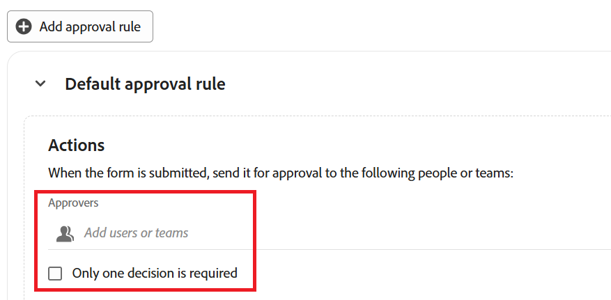
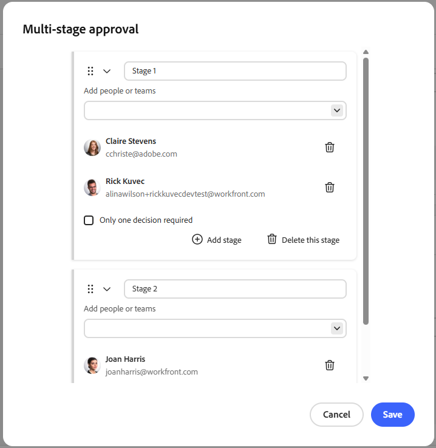
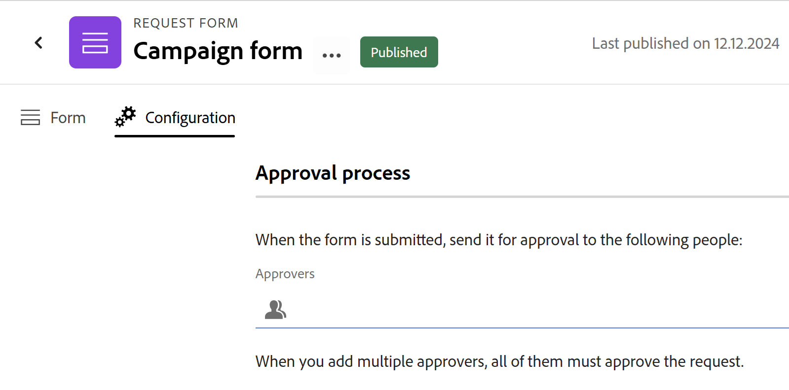

# Adobe Workfront Planning でリクエストフォームへの承認の追加

<!--update the metadata with real information when making this available in TOC and in the left nav-->

<!--
The highlighted information on this page refers to functionality not yet generally available. It is available only in the Preview environment for all customers. After the release to Preview, the same features are also available monthly in the Production environment for customers who enabled fast releases.    

For information about fast releases, see [Enable or disable fast releases for your organization](/help/quicksilver/administration-and-setup/set-up-workfront/configure-system-defaults/enable-fast-release-process.md). 
-->

{{planning-important-intro}}

Adobe Workfront Planning リクエストフォームに承認プロセスを追加して、レコードを作成する前に、送信されたすべてのリクエストの承認を開始できます。

承認プロセスでは、複数の段階に対応しています。 ステージで必要なすべての意思決定が行われると、次のステージが開始され、新しいステージの承認者にメール通知が送信されます。

この記事では、ワークスペース管理者が、レコードタイプに関連付けられたリクエストフォームに承認を追加する方法について説明します。

Workfront Planningでのリクエストフォームの作成について詳しくは、[Adobe Workfront Planningでのリクエストフォームの作成と管理](/help/quicksilver/planning/requests/create-request-form.md)を参照してください。

レコードを作成するためのレコードタイプへのリクエストの送信について詳しくは、[&#x200B; レコードを作成するためのAdobe Workfront計画リクエストの送信](/help/quicksilver/planning/requests/submit-requests.md)を参照してください。

## アクセス要件

+++ 展開すると、この記事の機能のアクセス要件が表示されます。 

<table style="table-layout:auto"> 
<col> 
</col> 
<col> 
</col> 
<tbody> 
<tr> 
   <td role="rowheader">
Adobe Workfront パッケージ
</td> 
   <td> 
<ul> 
<li>
プランニングパッケージを含む任意のWorkfrontまたはワークフロー
</li>
または
<li>
スタンドアロン製品として購入された場合の任意のプランニング・パッケージ
</li></ul>
   </td> </tr>
  <tr> 
   <td role="rowheader">
Adobe Workfront プラン
</td> 
   <td>
Workflow Standard

   </td> 
  </tr> 
<tr> 
   <td role="rowheader">
Adobe計画ライセンス
</td> 
   <td>
計画標準

   </td> 
  </tr> 
<tr> 
   <td role="rowheader">
アクセスレベル設定
</td> 
   <td> 
ワークフローとPlanning パッケージの両方を持っている場合は、ワークフローとPlanning ライセンスタイプの両方をアクセスレベルに追加する必要があります
   
</td> 
  </tr>  
  <tr> 
   <td role="rowheader">
オブジェクト権限
</td> 
   <td>   
ワークスペースとレコードタイプ </a>に対する権限を管理 
  
   
システム管理者は、作成しなかったワークスペースも含め、すべてのワークスペースに対する権限を持っています。
  </td> 
  </tr>  
</tbody> 
</table>

Workfrontのアクセス要件について詳しくは、[Workfront ドキュメント &#x200B;](/help/quicksilver/administration-and-setup/add-users/access-levels-and-object-permissions/access-level-requirements-in-documentation.md)のアクセス要件を参照してください。

+++

## リクエストフォームへの承認の追加に関する考慮事項

* 1人または複数の承認者（ユーザーまたはチーム）をリクエストフォームまたは承認ルールに追加できます。
* 承認ルールは、送信されたリクエスト内のフィールド値に基づいてリクエストをルーティングします（例：「キャンペーンタイプ」フィールドの異なる値に対して異なる承認者）。
* 作成したレコードの承認情報は、「承認者」フィールドと「承認日」フィールドで表示できます。 フィールドの作成を参照してください。
* すべての承認者が承認すると、リクエストフォームに関連付けられたレコードタイプのレコードが作成されます。
* 少なくとも1人の承認者が拒否した場合、レコードタイプのレコードは作成されません。代わりに、リクエストはWorkfrontのリクエスト領域に残ります。 （この点は、少し異なる文言で両方のセクションに表示されました。ここでは1つのステートメントとしてマージされます。）
* 複数の承認者が必要な場合は、「1つの決定のみが必要」オプションが有効になっていない限り、すべての承認者がリクエストを承認または却下する前に決定を下す必要があります。
* チームが承認者として設定されている場合、そのチームのひとりのメンバーから必要な決定はひとつだけです。
* 承認はオプションです。リクエストフォームに承認が添付されていない場合、Workfront Planningは送信時にすぐにレコードを作成します。
* 承認には、1つ以上のステージを追加できます。

## リクエストフォームへの承認ルールの追加

承認ルールは、送信されたリクエストのフィールド値に基づいて承認プロセスを定義します。

例えば、リクエストフォームに「Campaign type」フィールドがある場合、そのフィールドに「Digital」という値がある場合は1人に、そのフィールドに「Print」という値がある場合は別のユーザーにリクエストを送信するルールを作成できます。

リクエストフォームの承認ルールを設定するには：

1. 記事[Adobe Workfront Planning](/help/quicksilver/planning/requests/create-request-form.md)のリクエストフォームの作成と管理の説明に従って、レコードタイプのリクエストフォームの作成を開始します。
1. リクエストフォームが開いたら、**設定**&#x200B;をクリックします。

   「**設定**」タブが開きます。

1. 承認ルールの設定を開始するには、左側のパネルで&#x200B;**承認** をクリックします。

1. （オプション）デフォルトの承認プロセスを設定する場合は、**デフォルトの承認ルール**&#x200B;領域の&#x200B;**承認者** フィールドに少なくとも1人のユーザーまたはチームを追加し、**デフォルトの承認者のいずれかが承認した後にレコードを作成する場合は、「1つの決定のみが必要です**」チェックボックスをクリックします。

   

1. （オプション）承認ルールの追加を開始します。 カスタム承認ルールごとに、次の操作を行います。

   1. 「**承認ルールを追加**」をクリックします。
   1. プレースホルダータイトル **名称未設定の承認ルール**&#x200B;をクリックし、承認ルールの名前を入力します。
   1. 「**フィールドを選択**」をクリックし、ルールをアクティブ化するフィールドを選択します。
   1. ルールの演算子を選択します。 演算子は、フィールドのタイプによって異なります。
   1. 選択した演算子に値が必要な場合は、プラスアイコンをクリックして1つ以上の値を追加します。
   1. （オプション）「**条件を追加**」をクリックして、さらに条件を追加し、手順C-Eに従って追加条件を設定して&#x200B;**And**&#x200B;または&#x200B;**Or** ステートメントで接続します。
   1. 承認ルールの&#x200B;**アクション**&#x200B;領域の&#x200B;**承認者** フィールドに、条件が満たされたときに承認者として設定するユーザーまたはチームを少なくとも1つ追加します。
   1. （条件付き、オプション）承認者のいずれかがレコードを承認した後にレコードを作成する場合は、「**1つの決定のみが必要です**」チェックボックスをオンにします。 そうでない場合、すべての承認者は、リクエストが承認または却下される前に、承認を決定する必要があります。

   >[!NOTE]
   >
   >   承認ルールを追加する際には、次の点を考慮してください。
   >
   >   * デフォルトのルールのみが設定されている場合、送信されたすべてのリクエストに適用されます。
   >   * カスタムルールが満たされた場合、デフォルトはリクエスト承認ワークフローに適用されません。 一致したカスタムルールのみが承認に適用され、デフォルトのルールは無視されます。
   >   * 複数のカスタムルールが満たされた場合、順序の最初のルールが適用されます。 この場合、デフォルトの承認は適用されません（存在する場合）。

1. （オプション）「**ステージを追加**」をクリックして、承認に別のステージを追加します。

1. **保存**&#x200B;をクリックして、承認ルールを保存します。

1. （オプション）承認にさらにステージを追加するには、次の操作を行います。

   1. 「**ステージを追加**」をクリックします。

      「**複数段階の承認**」ボックスが表示されます。 既にデフォルトの承認アクションを作成している場合、これらの承認者は自動的にステージ 1に追加されます。

   1. 「**ユーザーまたはチームを追加**」フィールドに、ステージの承認者として設定するユーザーまたはチームを少なくとも1つ追加します。
   1. （条件付き、オプション）承認者のいずれかがレコードを承認した後、レコードを次のステージに進める場合は、「**1つの決定のみが必要です**」チェックボックスをオンにします。 そうでない場合、リクエストが次のステージに移動する前に、すべての承認者が承認を決定する必要があります。
   1. 「**ステージを追加**」をクリックし、手順Bから繰り返して、さらにステージを承認に追加します。

      2つ以上のステージが存在する場合は、**ドラッグ** アイコン をクリックして、順番にドラッグ&amp;ドロップできます。

      **このステージを削除**&#x200B;をクリックして承認からステージを削除するか、承認者の横にある&#x200B;**削除** アイコン をクリックして、ステージの承認者リストからユーザーまたはチームを削除します。

      

   1. 承認ワークフローの作成が完了したら、**保存**&#x200B;をクリックします。

      複数段階の承認は、「承認」ページで編集または削除できます。

1. （オプション） リクエストフォームを一度も共有したことがない場合は、**公開**&#x200B;をクリックします。

<!--

## Add an approval to a request form in the Production environment

1. Start creating a request form for a record type, as described in [Create and manage a request form in Adobe Workfront Planning](/help/quicksilver/planning/requests/create-request-form.md).
1. Click **Configuration**.

    The **Configuration** area displays.

    
1. In the **Approvers** field, start typing the name of a user or team that you want to set as an approver, then select it when it displays in the list. 
1. (Optional and conditional) If you have set more than one approver, and only need one approver to make a decision, enable the **Only one decision is required** option.

    (****most of the Note below is duplicated in the Create a request form article***)

      >[!NOTE]
      >
      >
      >* You can add one or several approvers to a request form.
      >
      >* If you add more than one approver, and the Only one decision is required option is not enabled, all approvers must approve the request before Workfront Planning creates a record.
      >
      >* If at least one approver rejects the request, the request is rejected and the record is not created. The request remains in the Requests area of Workfront.
      >
      >* If you add more than one approver, and the Only one decision is required option is not enabled, all approvers must make a decision before a request is either approved or rejected.
      >
      >* If a team is set as an approver, only one decision is required from the team.

1. (Optional) Click **Publish** if you have never shared the request form before.

    Or

    Click **Share** to share the form, then **Copy link**. 
1. (Optional) After a user uses the link you share and submits a request, Workfront Planning sends an approval in-app notification and an email to the approvers.

   For information about approving requests, see [Approve a request](/help/quicksilver/planning/requests/approve-request.md).

-->