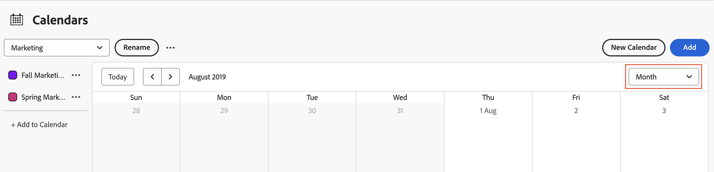
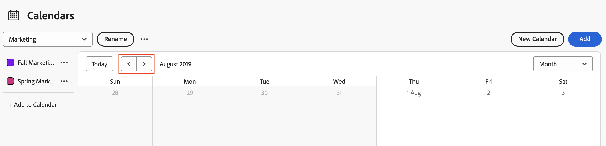
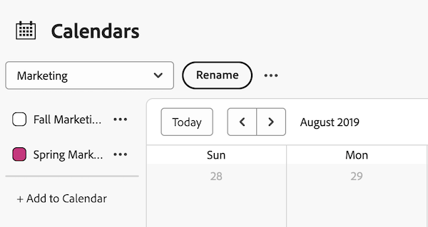

# カレンダーレポートとイベントの詳細を表示

{{highlighted-preview}}

Adobe Workfront で作成または共有したカレンダーレポートおよびイベントの詳細を表示できます。

## アクセス要件

+++ 展開すると、この記事の機能のアクセス要件が表示されます。

<table style="table-layout:auto"> 
 <col> 
 </col> 
 <col> 
 </col> 
 <tbody> 
  <tr> 
   <td role="rowheader">Adobe Workfront パッケージ</td> 
   <td> 
任意
 </td> 
  </tr> 
  <tr> 
   <td role="rowheader">Adobe Workfront プラン</td> 
   <td>
コントリビューター

       
リクエスト
</td> 
  </tr> 
  <tr> 
   <td role="rowheader">アクセスレベル設定</td> 
   <td> 
レポート、ダッシュボード、カレンダーへの表示以上のアクセス
</td> 
  </tr> 
  <tr> 
   <td role="rowheader">オブジェクト権限</td> 
   <td>カレンダーレポートに対する表示権限またはそれ以上の権限</td> 
  </tr> 
 </tbody> 
</table>

この表の情報について詳しくは、[Workfront ドキュメントのアクセス要件](/help/quicksilver/administration-and-setup/add-users/access-levels-and-object-permissions/access-level-requirements-in-documentation.md)を参照してください。

+++

## カレンダーレポートの表示

<!--{{step1-to-calendars}}-->

1. Adobe Workfront の右上隅にある&#x200B;**[!UICONTROL メインメニュー]**&#x200B;アイコン  をクリックするか、（利用可能であれば）左上隅にある&#x200B;**[!UICONTROL メインメニュー]**&#x200B;アイコン 、「**[!UICONTROL カレンダー]**」の順にクリックします。

   アクセスレベルに応じて、次のカレンダーが表示される場合があります。

   * 既定の[!DNL Adobe Workfront] カレンダー

     Workfront は、自分に割り当てられているプロジェクト、タスクおよびイシューに基づいて、または自分が割り当てられているチーム、グループまたは役割に基づいて、ユーザー用のカレンダーを作成します。

   * 作成したカレンダー

     カレンダーの作成について詳しくは、[カレンダーレポートの概要](../../../reports-and-dashboards/reports/calendars/calendar-reports-overview.md)を参照してください。

   * 他のユーザーが共有したカレンダー

     カレンダーの共有については、[[!UICONTROL カレンダーの共有]レポート](../../../reports-and-dashboards/reports/calendars/share-a-calendar-report.md)を参照してください。

1. （条件付き）**[!UICONTROL 表示]**ドロップダウンリストをクリックして、表示するカレンダー期間を選択します。
   
   次のカレンダーレポートビューから選択できます。

   * **[!UICONTROL 月]**：4 週間のカレンダーを表示します
   * **[!UICONTROL 週]**：1 週間のカレンダーを表示します
   * **[!UICONTROL ガント]**: カレンダーの連続表示を表示します

     下または横にスクロールすると、**ガント**&#x200B;表示でより多くのイベントを確認できます。 ビューのデータが入力されると、読み込み記号が表示されます。

   >[!NOTE]
   >
   >カレンダーには、最大5年後までのイベントを表示できます。

   >[!NOTE]
   >
   >**月**&#x200B;のビューおよび&#x200B;**週**&#x200B;のビューでは、現在または将来のイベント（今日の日付または将来の日付を含められた複数日にわたるイベントを含む）には、プロジェクトまたはカレンダーグループの色に対応する網掛けが適用されます。 過去のイベントの淡色の網掛けで表示され、現在のイベントではないことを示しますが、これらのイベントを選択して表示することはできます。

1. （オプション）カレンダーを&#x200B;**月**&#x200B;のビューまたは&#x200B;**週**&#x200B;のビューで表示する場合、次のオプションを使用してカレンダー表示を変更できます。

   <table style="table-layout:auto"> 
    <col> 
    </col> 
    <col> 
    </col> 
    <tbody> 
     <tr> 
      <td role="rowheader">月ビューでカレンダーを表示する場合の週末の除外</td> 
      <td>カレンダーの右上隅にある「<b>週末を表示</b>」のオンとオフを切り替えます。</td> 
     </tr> 
     <tr> 
      <td role="rowheader"><b>[!UICONTROL Week]</b> ビューでカレンダーを表示する場合の時刻の表示と非表示の切り替え</td> 
      <td>カレンダーの右上隅で、<b>時間を表示</b>のオンとオフを切り替えます。</td> 
     </tr> 
     <tr> 
      <td role="rowheader">表示日をすばやく変更するには</td> 
      <td> 
<b>[!UICONTROL カレンダー]</b> ツールバーで、日付インジケーターの左矢印をクリックしてカレンダーに戻るか、右矢印をクリックして先に進みます。
 

 
表示される日付は、現在のカレンダービューに基づいて間隔で調整されます。 例えば、<b>週</b>のビューでカレンダーを表示している場合、選択した矢印に応じて、1 週間後に進むかまたは 1 週間前に戻った表示になります。
 
（オプション）現在の日付に戻すには、<b>[!UICONTROL Today]</b>をクリックします。
 </td> 
     </tr> 
    </tbody> 
   </table>

1. （オプション）カレンダーにリンクされたプロジェクトまたはカレンダーのグループ化のイベントを非表示にするには、プロジェクトリストのプロジェクトまたはカレンダーのグループ化をオフにします。
   
   プロジェクトリストで[!UICONTROL  プロジェクト ]またはカレンダーグループを選択すると、イベントを再度表示できます。

## カレンダーレポートイベントの詳細を表示

現在のイベントおよび過去のイベントの詳細は、カレンダーに表示されます。

1. 詳細を知りたいイベントに移動し、イベントをクリックします。 詳細は右側のパネルで開きます。
1. （オプション）関連するプロジェクト、タスクまたはイシューを開くには、オブジェクトのタイトルをクリックします。
