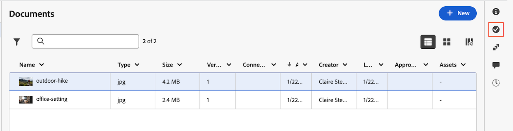

# グループ化された承認の管理

グループ化された承認では、複数のドキュメントが単一の承認ワークフローにバンドルされるため、すべてのドキュメントが同じステージを通過し、ドキュメントごとに個別の承認が必要になりません。 ワークフローを再作成しなくても、アクティブなグループ化された承認内の参加者とドキュメントを追加または削除できます。

グループ化された承認は、単一アセットの承認と同じように、基本モードと詳細モード、複数ステージ、並行パスをサポートします。 詳しくは、[&#x200B; ドキュメント承認ワークフローの作成](/help/quicksilver/review-and-approve-work/document-reviews-and-approvals/manage-document-approvals/create-a-document-approval.md)を参照してください。

>[!IMPORTANT]
>
>組織でAdobe クラウドストレージを使用している場合、Workfrontでドキュメントにアクセスすると、新しいドキュメント エリアが表示されます。 グループ化された承認は、新しいドキュメント領域でのみ使用できます。 Adobe クラウドストレージについて詳しくは、[Adobe クラウドストレージの概要](/help/quicksilver/review-and-approve-work/esm-overview.md)を参照してください。

## アクセス要件

+++ 展開すると、この記事の機能のアクセス要件が表示されます。

<table style="table-layout:auto">
 <col>
 <col>
 <tbody>
  <tr>
   <td role="rowheader">Adobe Workfront パッケージ</td>
   <td> 
Adobeのクラウドストレージを使用して承認を管理する任意のワークフローパッケージ
 </td>
  </tr>
  <tr>
   <td role="rowheader">Adobe Workfront プラン</td>
   <td>
   
コントリビューター以上

   
レビュー以上

   
Frame.io統合を使用している場合は、承認ワークフローを作成するための標準ライセンスが必要です。

   </td>
  </tr>
  <tr>
   <td role="rowheader">アクセスレベル設定</td>
   <td> 
プロジェクト、タスク、イシュー、テンプレート、ポートフォリオ、プログラム、レポート、ダッシュボード、カレンダー、ドキュメントへの表示以上のアクセス
</td>
  </tr>
  <tr>
   <td role="rowheader">オブジェクト権限</td>
   <td> 
リクエストまたは承認に関連付けられているオブジェクトへのアクセスを管理します
</td>
  </tr>
 </tbody>
</table>

詳しくは、[Workfront ドキュメントのアクセス要件](/help/quicksilver/administration-and-setup/add-users/access-levels-and-object-permissions/access-level-requirements-in-documentation.md)を参照してください。

+++

## アクティブなグループ化された承認への参加者の追加

ステージがアクティブな間、既に進行中の承認を中断することなく、承認者またはレビュー担当者をグループ化された承認に追加できます。

アクティブなグループ化された承認に参加者を追加するには：

1. グループ化された承認を含むプロジェクト、タスク、またはイシューに移動し、左側のパネルで「**ドキュメント**」を選択します。

1. グループ内の任意のドキュメントをクリックし、ページの右側にある&#x200B;**承認** アイコンをクリックします。

   

1. 「**ワークフローを編集**」をクリックします。

1. アクティブなステージの&#x200B;**名前またはメールを追加** フィールドにユーザー、チーム、またはメールを入力します。

1. 追加する各ユーザーについて、承認者かレビュアーかを選択します。

1. 「**保存**」をクリックします。

   新しい参加者には、グループ内のすべてのオープン承認がキューに表示されます。 追加される前に決定がおこなわれたことは表示されないので、現在開いているすべての承認を自分で完了する必要があります。

## アクティブなグループ化された承認から参加者を削除する

ステージがアクティブな間、グループ化された承認から承認者またはレビュー担当者を削除できます。 削除された参加者は、グループの承認をキューに表示するのをただちに停止しますが、既に行った決定は保持され、リセットされません。

アクティブなグループ化された承認から参加者を削除するには：

1. グループ化された承認を含むプロジェクト、タスク、またはイシューに移動し、左側のパネルで「**ドキュメント**」を選択します。

1. グループ内の任意のドキュメントをクリックし、ページの右側にある&#x200B;**承認** アイコンをクリックします。

   

1. 「**ワークフローを編集**」をクリックします。

1. アクティブなステージから削除する参加者を見つけ、名前の横にある&#x200B;**削除** アイコンをクリックします。

1. 「**保存**」をクリックします。

## グループ化された承認へのドキュメントの追加

最初のステージがロックされるまで、グループ化された承認にドキュメントを追加できます。 最初のステージがロックされると、ドキュメントを追加できなくなります。

グループ化された承認に文書を追加するには：

1. グループ化された承認を含むプロジェクト、タスク、またはイシューに移動し、左側のパネルで「**ドキュメント**」を選択します。

1. グループ内の任意のドキュメントをクリックし、ページの右側にある&#x200B;**承認** アイコンをクリックします。

1. 「**ワークフローを編集**」をクリックし、「**ドキュメント**」タブをクリックします。

1. グループに追加する1つまたは複数のドキュメントを選択します。

1. 「**保存**」をクリックします。

   グループ内のすべての参加者には、レビュー用に追加ドキュメントが追加されたことが通知されます。

## グループ化された承認からのドキュメントの削除

ワークフローの任意の時点で、グループ化された承認からドキュメントを削除できます。 削除されたドキュメントは、独立した承認となり、再起動することなく、既存の決定、コメント、履歴のすべてを保持します。 ドキュメントには既に承認決定が含まれているため、後でグループ化された承認に追加することはできません。

グループ化された承認からドキュメントを削除するには：

1. グループ化された承認を含むプロジェクト、タスク、またはイシューに移動し、左側のパネルで「**ドキュメント**」を選択します。

1. 削除するドキュメントをクリックし、ページの右側にある&#x200B;**承認** アイコンをクリックします。

1. 「**ワークフローを編集**」をクリックし、「**ドキュメント**」タブをクリックします。 選択した文書はリストの上部にピン留めされ、既にチェックされています。

1. グループから削除する文書の選択範囲をクリアします。

1. 「**保存**」をクリックします。

   >[!NOTE]
   >
   >ドキュメントの承認ステータスは、削除された時点から表示され、変更されません。 グループ化された承認ビューが更新され、グループ内の残りの文書が反映されます。

## 多段階のグループ化された承認で、単一の文書に対して「作業が必要」という決定を解決する

多段階のグループ化された承認では、グループが次のステージに進むためには、ステージ内のすべての文書が決定に達する必要があります。 ドキュメントに「**作業が必要**」というマークが付いている場合、そのドキュメントはグループの残りの部分を進めることができないため、ステージを進めるにはグループから手動で削除する必要があります。

グループからドキュメントを削除すると、そのドキュメントは独立した承認となり、再開せずに既存の決定、コメント、履歴がすべて保持されます。 更新されたドキュメントをスタンドアロンの承認に新しいバージョンとして追加したり、新しいグループ化された承認を作成したりできます。

「作業が必要」の決定を解決するには：

1. 「**作業が必要**」とマークされた文書をグループから削除します。 詳細については、[&#x200B; グループ化された承認からのドキュメントの削除](#remove-documents-from-a-grouped-approval)を参照してください。 削除された文書は、独自のスタンドアロン承認となり、既存の決定、コメント、履歴を保持します。

1. ドキュメントを更新したら、新しいバージョンとしてアップロードし、再度承認をリクエストするか、新しいグループの一部として追加します。

   詳しくは、次を参照してください。

   * [新しいドキュメントバージョンのアップロードと承認のリクエスト](/help/quicksilver/review-and-approve-work/document-reviews-and-approvals/manage-document-approvals/upload-new-doc-version.md)
   * [ドキュメント承認ワークフローの作成](create-a-document-approval.md)
   * [グループ化された承認の作成](create-a-grouped-approval.md)

## 既知の制限事項

グループ化された承認でドキュメントを追加または削除すると、Frame.ioに一時的な同期の問題が発生します。 変更内容は、次回ドキュメントが同期されるまでFrame.ioに反映されません。