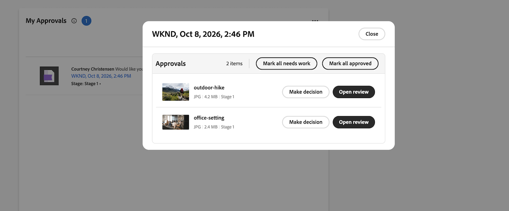

# グループ化された承認のレビュー

{{highlighted-preview-article-level}}

グループ化された承認に割り当てると、グループ内のすべての文書が一緒に表示されるので、それぞれの文書について決定を下すことができます。 すべてのドキュメントに対して一度に変更を承認または要求したり、各ドキュメントに対して個別に決定を下したりできます。

複数段階のグループ化された承認で1つ以上の文書に&#x200B;**作業が必要**&#x200B;とマークされている場合、グループ内のすべての文書に承認済みの決定が表示されるまで、グループは次の段階に進むことができません。 詳細については、[複数段階のグループ化された承認で、単一の文書に対する「必要な作業」決定を解決する](#resolve-a-needs-work-decision-on-a-single-document-in-a-multi-stage-grouped-approval)を参照してください。

>[!IMPORTANT]
>
>組織でAdobe クラウドストレージを使用している場合、Workfrontでドキュメントにアクセスすると、新しいドキュメント エリアが表示されます。 グループ化された承認は、新しいドキュメント領域でのみ使用できます。 Adobe クラウドストレージについて詳しくは、[Adobe クラウドストレージの概要](/help/quicksilver/review-and-approve-work/esm-overview.md)を参照してください。

## アクセス要件

+++ 展開すると、この記事の機能のアクセス要件が表示されます。

<table style="table-layout:auto">
 <col>
 <col>
 <tbody>
  <tr>
   <td role="rowheader">Adobe Workfront パッケージ</td>
   <td> 
Adobeのクラウドストレージを使用して承認を管理する任意のワークフローパッケージ
 </td>
  </tr>
  <tr>
   <td role="rowheader">Adobe Workfront プラン</td>
   <td>
   
コントリビューター以上

   
レビュー以上

   </td>
  </tr>
  <tr>
   <td role="rowheader">アクセスレベル設定</td>
   <td> 
承認に関連付けられたオブジェクトに対する表示以上のアクセス権
</td>
  </tr>
  <tr>
   <td role="rowheader">オブジェクト権限</td>
   <td> 
承認に関連付けられたオブジェクトに対する表示以上の権限
</td>
  </tr>
 </tbody>
</table>

詳しくは、[Workfront ドキュメントのアクセス要件](/help/quicksilver/administration-and-setup/add-users/access-levels-and-object-permissions/access-level-requirements-in-documentation.md)を参照してください。

+++

## ホームのマイ承認ウィジェットからグループ化された承認を確認する

ホームのマイ承認ウィジェットでは、1つの承認の下にドキュメントがグループ化されるので、すべてのドキュメントを一緒に操作できます。

>[!NOTE]
>
>マイ承認ウィジェットをホームページに追加する必要がある場合があります。 詳細については、「[&#x200B; ホームでウィジェットを追加、編集、または削除する](/help/quicksilver/workfront-basics/using-home/using-the-home-area/add-edit-remove-widgets-in-new-home.md)」を参照してください。

1. Adobe Workfrontの左上隅にある&#x200B;**ホーム** アイコンをクリックし、**自分の承認** ウィジェットを見つけます。

1. グループ化された承認を開きます。 グループ内のすべての文書が一覧表示され、グループ内の項目数が一番上に表示されます。

1. 次のいずれかを使用して決定します。

   * **すべての承認済み**&#x200B;をマーク：グループ内のすべてのドキュメントに対して、承認済みの決定を一度に記録します。
   * **すべての必要な作業をマーク**: グループ内のすべての文書に対する必要な作業の決定を一度に記録します。
   * **決定**：単一のドキュメントに対して個別の決定を行います。 個別に決定する各ドキュメントに対して、を繰り返します。

   

## Frame.io ビューアでグループ化された承認を確認する

Frame.io ビューアでは、グループ内のすべてのドキュメントが一緒に表示されるので、各ドキュメントを素早く決定したり、ドキュメントを開いて詳細を確認したりできます。

1. レビューメール通知に移動し、**レビューに移動**&#x200B;するか、ホームの&#x200B;**マイ承認** ウィジェットからグループ化された承認を開きます。

1. 次のいずれかの操作を行います。

   * グループページを開かずに、各ドキュメントについてグループページから直接決定します。
   * 文書をクリックして開き、コメントまたはマークアップを追加してから、矢印を使用してグループ内の次の文書に移動します。 ドキュメント カウンター（例：**1 / 2**）は、グループ内のあなたの場所を示します。

   Frame.io ビューアでのコメントとマークアップについて詳しくは、[Frame.io ビューアでのレビューと承認](/help/quicksilver/review-and-approve-work/document-reviews-and-approvals/review-with-frame.md)を参照してください。

1. 各ドキュメントの決定を選択：

   * **承認済み**: ドキュメントは変更が必要なく、使用する準備ができています。
   * **作業が必要**：文書は変更が必要で、使用する準備ができていません。

   決定の詳細については、[&#x200B; ドキュメント決定ステータスの概要](/help/quicksilver/review-and-approve-work/document-reviews-and-approvals/manage-document-approvals/document-approval-status.md)を参照してください。

   

## 追加のリソース

この記事では、ドキュメントのグループのレビューに関する情報について説明します。 1つの文書に対して決定を行う方法や、マークアップを追加する方法などについては、「

* [Workfrontでのドキュメントの承認](/help/quicksilver/review-and-approve-work/document-reviews-and-approvals/review-and-approve-documents/approve-a-document.md)
* [Workfront でのドキュメントのレビュー](/help/quicksilver/review-and-approve-work/document-reviews-and-approvals/review-and-approve-documents/review-a-document.md)
* [Frame.io ビューアでのレビューと承認](/help/quicksilver/review-and-approve-work/document-reviews-and-approvals/review-with-frame.md)