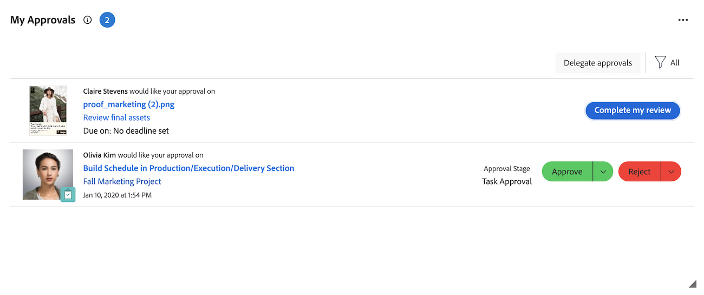

# マイ承認ウィジェットを使用した承認の管理

マイ承認ウィジェットには、保留中、割り当て済み、委任済み、送信済みのすべての承認が1か所に表示されます。 ここでは、承認のフィルタリングと整理、意思決定、必要に応じた承認の委任を行うことができます。

My Approvals ウィジェットでは、次のWorkfront オブジェクトからの承認をサポートしています。

* タスク
* イシュー
* プロジェクト
* ドキュメント
* プルーフ
* プランニングレコードのリクエスト
* タイムシート

>[!NOTE]
>
>組織でAdobe クラウドストレージを使用している場合、ドキュメントを含むプロジェクトが共有されている場合にのみ、ドキュメントの承認がウィジェットに表示されます。

## アクセス要件

+++ 展開すると、この記事の機能のアクセス要件が表示されます。

<table style="table-layout:auto"> 
 <col> 
 <col> 
 <tbody> 
  <tr> 
   <td role="rowheader">Adobe Workfront パッケージ</td> 
   <td> 
任意
 </td> 
  </tr> 
  <tr> 
   <td role="rowheader">Adobe Workfront プラン</td> 
   <td> 
   
コントリビューター以上

   
レビュー以上
 </td> 
  </tr> 
  <tr> 
   <td role="rowheader">アクセスレベル設定</td> 
   <td> 
承認に関連付けられたオブジェクトに対する表示以上のアクセス権
</td> 
  </tr> 
  <tr> 
   <td role="rowheader">オブジェクト権限</td> 
   <td> 
承認に関連付けられたオブジェクトに対する表示以上の権限
</td> 
  </tr> 
 </tbody> 
</table>

詳しくは、[Workfront ドキュメントのアクセス要件](/help/quicksilver/administration-and-setup/add-users/access-levels-and-object-permissions/access-level-requirements-in-documentation.md)を参照してください。

+++

## 自分の承認ウィジェットからの作業の承認

1. 右上隅の&#x200B;**[!UICONTROL メインメニュー]** をクリックし、**[!UICONTROL ホーム]**&#x200B;をクリックします。
1. （条件付き）「**カスタマイズ**」をクリックして、**自分の承認** ウィジェットを追加します。
1. （オプション）自分の承認ウィジェットのフィルターオプションを調整して、表示する承認を選択します。 次のフィルターオプションを使用できます。

   | フィルターオプション | 説明 |
   |--------|-------------|
   | すべて | 自分に割り当てられ、他のユーザーから委任され、自分が送信したすべての承認が表示されます。 |
   | マイ承認 | 割り当てられた承認を表示します。 これはデフォルトのオプションです。 |
   | 委任された承認 | 他のユーザーから委任された承認を表示します。 |
   | 送信した承認 | 他のユーザーに送信した承認を表示します。 |

   >[!NOTE]
   >
   >担当業務またはグループに割り当てられた承認は、ホームに表示されません。 チームに割り当てられた承認は、各チームメンバーのマイ承認ウィジェットに表示されます。

1. （条件付き）「**並べ替え**」ドロップダウンメニューをクリックし、**最新の最初の**」を選択して、最近追加された承認を表示します。

1. （オプション）全画面表示アイコン をクリックして、自分の承認ウィジェットを全画面表示で開きます。

1. 承認する項目を選択します。

   

   <!--update screenshot after production release-->

1. 右側のパネルで承認を決定する際に、使用可能なオプションの 1 つをクリックします。 承認する項目のタイプに応じて、ページの右上隅に次のオプションが表示されます。

   <table>
   <tr>
      <td>
      
<strong>アクセス</strong>

      </td>
      <td>
      
<strong>作業項目</strong>

      </td>
      <td>
      
<strong>ドキュメント</strong>

      </td>
      <td>
      
<strong>プルーフ</strong>

      </td>
   </tr>
   <tr>
      <td>
       <ul>
      <li>付与</li>
      <li>無視</li>
      </ul>
      必要に応じて、<b> アクセス権の変更</b> ドロップダウンメニューでアクセス権のレベルを調整できます。
      </td>
      <td>
         <ul>
         <li>承認</li>
         <li>Reject</li>
         </ul>
      決定ボタンのドロップダウンメニューをクリックして、決定にコメントを残すことができます。
      </td>
      <td>
   承認者として割り当てられた
         <ul>
         <li>承認</li>
         <li>変更して承認</li>
         <li>作業が必要</li>
         </ul>
   レビュアーとして割り当てられました
         <ul>
         <li>レビューの完了</li>
         </ul>
      この列のオプションは、統合承認にのみ適用されます。 レガシードキュメントの承認は、作業項目の承認と同じように表示されます。 
      </td>
      <td>
         <ul>
         <li>プルーフを見る</li>
         </ul>
         プルーフビューアで決定します。 プルーフの確認について詳しくは、<a href="/help/quicksilver/review-and-approve-work/proofing/reviewing-proofs-within-workfront/review-proofs-in-wf.md">Adobe Workfront でのプルーフのレビュー</a>を参照してください。
      </td>
   </tr>
   </table>

## 承認がウィジェットから削除されたとき

承認を決定すると、自分の承認ウィジェットから承認が削除されます。 承認は、次の状況でも削除されます。

* **作業の承認**: プロジェクトが次のいずれかのステータスにある場合、プロジェクト、タスク、イシューの承認がウィジェットから削除されます。
  * 完了
  * 停止
  * 保留中

  >[!NOTE]
  >
  >プロジェクトが承認待ちの場合、現在の承認者に対するプロジェクト自身の承認は引き続き表示されますが、タスクやイシューに対する承認は表示されません。

* **レガシードキュメントの承認**：親オブジェクトではなく、ドキュメントが直接添付されているオブジェクトのステータスに基づいて、レガシードキュメントの承認がウィジェットから削除されます。 承認は、そのオブジェクトが次のいずれかのステータスにある場合に削除されます。
  * プロジェクト：完了または停止
  * タスク：完了
  * 問題：クローズ、またはクローズと等しいステータス。 これには、「解決済み」、「解決しない」、「重複できない」、「検証済み」が含まれます。

* **統合承認**：統合承認は、プロジェクト、タスク、イシューのステータスに関係なく、ウィジェットに残ります。 その表示は承認ワークフローと保留中の承認責任によって制御されるため、ワークフロー全体が完了する前に承認をウィジェットから削除できます。

カスタムステータスはEquates With マッピングに従うため、上記のいずれかのステータスと等しいステータスは同じ結果になります。 オブジェクトがウィジェットから削除された場合でも、そのオブジェクトに対して承認が保留中のままになる可能性があります。 カスタムステータスについて詳しくは、[&#x200B; ステータスの作成または編集](/help/quicksilver/administration-and-setup/customize-workfront/creating-custom-status-and-priority-labels/create-or-edit-a-status.md)を参照してください。
